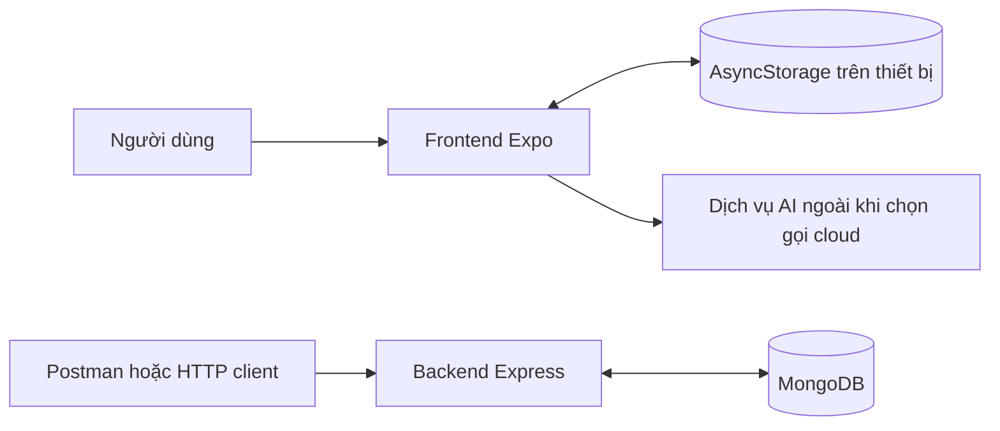
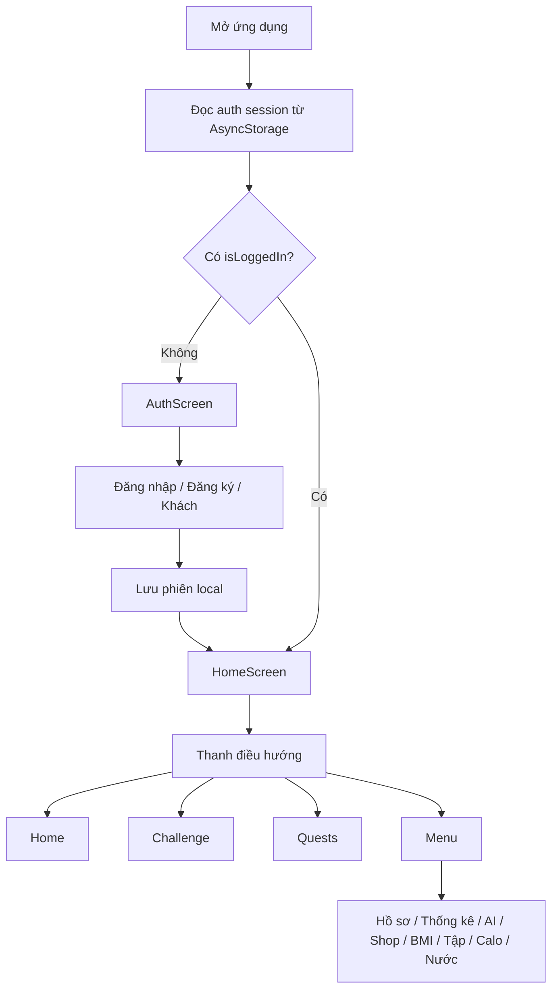
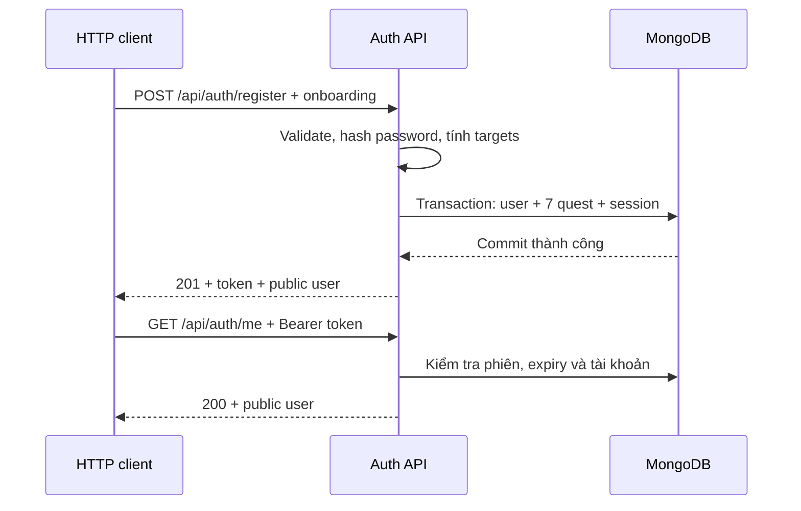
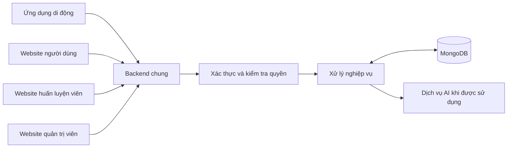
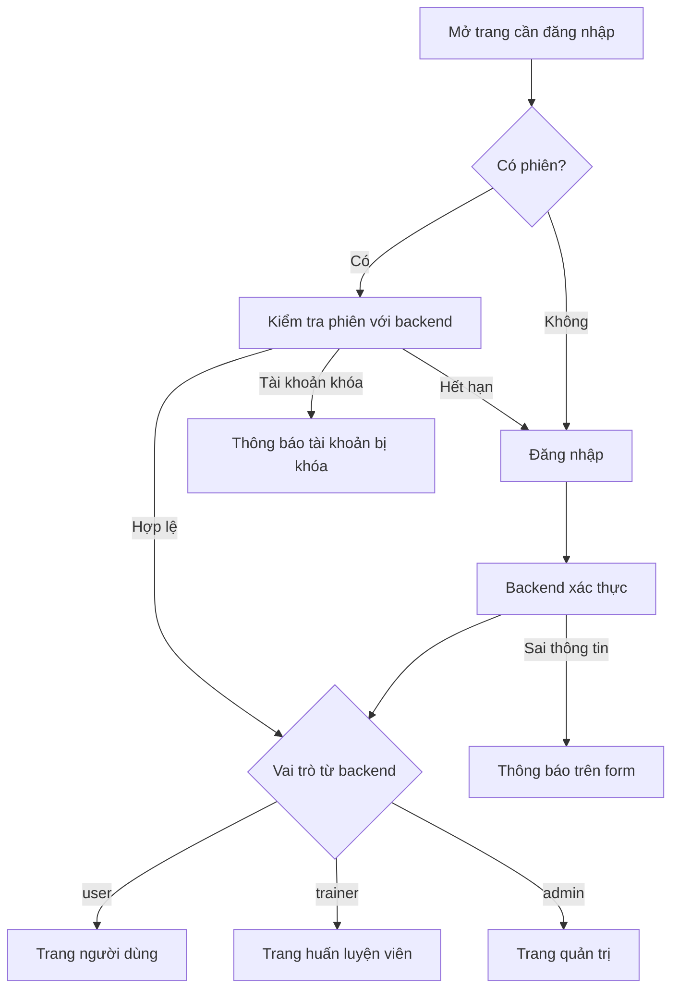
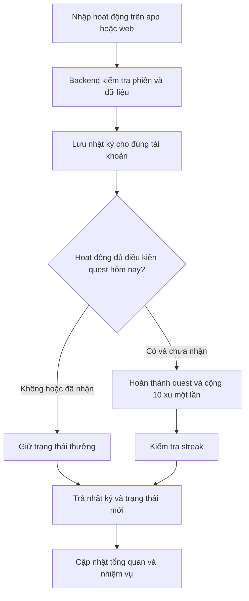
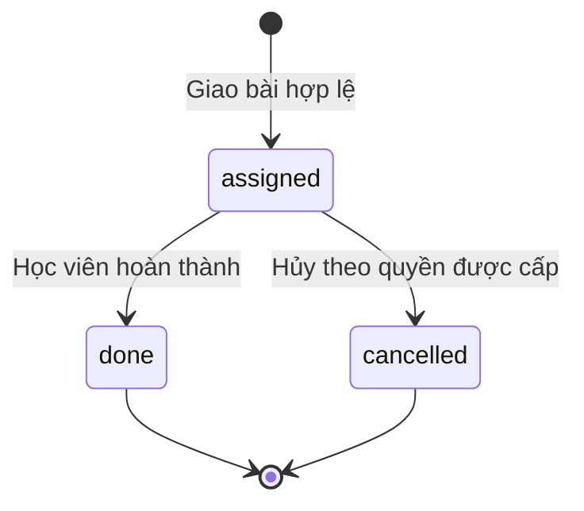

# FitLife — Luồng hoạt động app và website

Tài liệu mô tả hiện trạng ứng dụng FitLife và bổ sung thiết kế website cho người dùng, huấn luyện viên, quản trị viên. Bản rà soát và bổ sung ngày **29/10/2026**.

**Hiện trạng:** frontend Expo đang chạy bằng dữ liệu local trong AsyncStorage; backend Express đã có API đăng ký, đăng nhập, kiểm tra phiên và đăng xuất dùng MongoDB. Hai phần này **chưa được nối với nhau trong frontend hiện tại**. Các phần ghi “luồng mục tiêu” bên dưới là nghiệp vụ cần triển khai tiếp.

## Đánh giá và phạm vi bổ sung ngày 29/10/2026

**Kết luận:** Luồng hiện tại hợp lý để giải thích bản demo và tình trạng phát triển. Tuy nhiên, chưa đủ để làm đặc tả triển khai đồng bộ app–website vì còn lệch nghiệp vụ giữa frontend và backend, thiếu luồng ba vai trò trên website và thiếu một số trường hợp lỗi. Có thể giữ phần hiện trạng làm nền, rồi dùng phần bổ sung dưới đây để hoàn thiện thiết kế.

Tài liệu này giữ nội dung gốc ở mục 1–10, gồm hiện trạng, hướng tích hợp ở mục 9 và cách chạy; bổ sung luồng website và các quy tắc tích hợp ở mục 11–18. **Toàn bộ mục 11–18 là thiết kế mục tiêu; không có nghĩa website hoặc các API tương ứng đã được lập trình.** Những đề xuất vượt đặc tả database hiện có được ghi riêng để tránh nhầm là quyết định đã chốt.

### Những phần đã hợp lý

- Có vòng sử dụng rõ: tạo tài khoản → khai báo hồ sơ → ghi nhật ký → nhiệm vụ/xu → thử thách/đổi thưởng → theo dõi kết quả.
- Phân biệt được dữ liệu demo trên thiết bị, API xác thực đã có và nghiệp vụ mới ở mức schema.
- Backend đăng ký đã khởi tạo user, nhiệm vụ và phiên trong cùng transaction; thiết kế phân quyền đã có ba vai trò `user`, `trainer`, `admin`.
- Nhật ký gắn chủ sở hữu, ngày nghiệp vụ theo múi giờ và phần thưởng có yêu cầu chống nhận lặp là nền phù hợp cho việc dùng cả app lẫn web.

### Các điểm cần sửa trước khi tích hợp

1. **Một tài khoản, một nguồn dữ liệu.** Thay đăng nhập local bằng xác thực backend; dữ liệu cá nhân phải lấy theo user từ phiên. Cache tách theo tài khoản. Không tự nhập toàn bộ dữ liệu demo dùng chung vào tài khoản thật.
2. **Một bộ nhiệm vụ chung.** Dùng bộ v2: nước, tập, bữa ăn, ngủ, tâm trạng, điểm danh, chat. Chuẩn hóa `q_meals` thành `q_meal`; cân nặng vẫn là nhật ký riêng. Tiêu hóa chưa có collection riêng, nên chưa đưa vào phạm vi đồng bộ đầu tiên.
3. **Ghi hoạt động ở đâu cũng có cùng kết quả.** Ghi nước từ Home, màn hình Nước, Quests hoặc website đều qua một quy tắc backend. Không để cùng một hoạt động chỉ được thưởng nếu nhập từ một màn hình nhất định.
4. **Xu, streak và check-in do server quyết định.** Tài khoản thật bắt đầu 0 xu; không dùng mặc định 150 xu của demo. Thử thách tính số ngày check-in hợp lệ, không tăng cố định 10% mỗi lần bấm. Gửi lại yêu cầu hoặc thao tác đồng thời từ app/web không được thưởng hay trừ xu hai lần.
5. **Hồ sơ, mục tiêu và thống kê phải nhất quán.** Backend tính mục tiêu từ thông tin hồ sơ. Không để lưu BMI tự ghi đè mục tiêu calo theo quy tắc khác. Số bước/nhịp tim chưa có nguồn thật phải được đánh dấu demo hoặc ẩn; ngày thiếu dữ liệu cần phân biệt với số đo bằng 0.
6. **Bổ sung quyền và vòng đời trainer/admin.** Cần luồng cấp tài khoản theo vai trò, kết nối học viên, giao bài, kết thúc quyền xem dữ liệu, quản lý thử thách và vật phẩm. Đặc biệt phải ngăn trainer tự giao bài cho một người bất kỳ chỉ để mở quyền xem nhật ký.
7. **Bổ sung các nhánh thất bại.** Phiên hết hạn, tài khoản khóa, sai quyền, mất mạng, gửi trùng và dữ liệu bị thay đổi ở thiết bị khác đều cần kết quả rõ cho người dùng.

### Căn cứ và giới hạn kiểm tra

Nguồn chính là văn bản người dùng cung cấp. Trong lần bổ sung này đã đối chiếu chọn lọc `frontend/App.js`, `frontend/package.json`, `frontend/src/utils/storage.js`, `backend/app.js`, `backend/routes/auth.routes.js`, `backend/auth/registration.js`, `backend/auth/session.js`, schema MongoDB, `ROLE_CONTRACT.md` và `FitLife_Database_Specification.md` tại thư mục dự án `B:\DỰ ÁN HỌC\FitlifeMoblie`.

Đối chiếu xác nhận backend đã có đăng ký/đăng nhập/me/đăng xuất, `App.js` còn đọc phiên local, hai bộ quest còn khác nhau và frontend có lệnh `npm run web`. Các tài liệu database có câu “chưa lập trình API” là mô tả giai đoạn database trước đó; hiện trạng nhóm auth được xác định theo mã nguồn đang có.

Đây là rà soát tài liệu và mã nguồn chọn lọc, chưa chạy ứng dụng, kiểm thử API, truy cập Atlas hay xác minh trên thiết bị thật. Nội dung hiện trạng khác được giữ từ tài liệu gốc, không coi là kết quả kiểm thử mới.

**Cách đọc:** mục 1–8 mô tả hiện trạng, mục 9 nêu hướng tích hợp và mục 10 hướng dẫn chạy; mục 11–16 mô tả website mục tiêu; mục 17–18 nêu thứ tự triển khai, tiêu chí nghiệm thu và các quyết định cần chốt.

---

## 1. Tổng quan dự án

FitLife là ứng dụng theo dõi sức khỏe và luyện tập, kết hợp nhật ký hằng ngày với nhiệm vụ nhận xu, thử thách, cửa hàng vật phẩm và AI Coach.

- **Frontend:** React Native + Expo, tổ chức màn hình và xử lý thao tác người dùng.
- **Kho dữ liệu local:** AsyncStorage lưu hồ sơ, tài khoản demo, phiên local, nhật ký, xu, vật phẩm và lịch sử chat trên thiết bị.
- **Backend:** Node.js + Express, hiện cung cấp nhóm API xác thực.
- **Database:** MongoDB, có schema/index cho 16 collection nghiệp vụ; collection `auth_sessions` phục vụ phiên đăng nhập được bổ sung bởi backend.

### Luồng kết nối thực tế



Frontend hiện chưa gửi request xác thực hoặc nhật ký đến Express. Chạy backend thành công không tự làm dữ liệu trên giao diện được lưu vào MongoDB.

### Các vị trí mã nguồn chính

```text
FitlifeMoblie/
├── frontend/
│   ├── App.js                         # Kiểm tra phiên local, điều hướng 4 tab
│   └── src/
│       ├── screens/                   # Màn hình và modal chức năng
│       ├── utils/storage.js           # Đọc/ghi dữ liệu local, auth demo, nhiệm vụ, xu
│       ├── utils/aiService.js         # Context sức khỏe, AI local và gọi cloud
│       ├── utils/notifications.js     # Nhắc nhở cục bộ
│       └── constants/data.js          # Danh sách bài tập và món ăn mẫu
├── backend/
│   ├── server.js                      # Khởi động server sau khi kết nối database
│   ├── app.js                         # Middleware, health check, mount route
│   ├── config.js                      # Đọc cấu hình môi trường
│   ├── routes/auth.routes.js          # register, login, me, logout
│   ├── auth/                          # Mật khẩu, phiên, onboarding đăng ký
│   ├── database/connection.js         # Kết nối MongoDB và chuẩn bị auth_sessions
│   ├── database/mongodb/              # Schema v2, index, seed, migration, audit
│   ├── api/registration.postman_collection.json
│   └── test/auth.test.js              # Kiểm thử API với MongoDB tạm
└── readme2.md                         # Tài liệu luồng dự án
```

## 2. Luồng mở ứng dụng và điều hướng



1. `App.js` gọi `getAuthSession()` khi ứng dụng khởi động; trong lúc đọc dữ liệu hiển thị loading.
2. Chưa có phiên local hợp lệ theo cờ `isLoggedIn` thì mở `AuthScreen`.
3. Đăng nhập, đăng ký hoặc vào chế độ khách thành công thì cập nhật state và mở Home.
4. Thanh điều hướng có bốn tab: `home`, `activity`, `quests`, `menu`; tab `activity` thực tế render `ChallengeScreen`.
5. Các công cụ như hồ sơ, AI, Shop, BMI, tập luyện, calo và nước mở dưới dạng modal trong `MenuScreen`. Shortcut trên Home cũng đi qua Menu.
6. Đăng xuất tại hồ sơ gọi `clearAuthSession()`, cập nhật state ở `App.js` và quay lại màn hình xác thực.

`DashboardScreen.js` có trong thư mục nhưng không được `App.js` sử dụng làm màn hình chính hiện tại. Điều hướng đang được quản lý bằng React state.

Nguồn: [App.js](<B:/DỰ ÁN HỌC/FitlifeMoblie/frontend/App.js>), [MenuScreen.js](<B:/DỰ ÁN HỌC/FitlifeMoblie/frontend/src/screens/MenuScreen.js>).

## 3. Luồng tài khoản trên giao diện hiện tại

### 3.1. Đăng ký local

1. Người dùng nhập tên, email, mật khẩu và xác nhận mật khẩu.
2. `AuthScreen` kiểm tra dữ liệu, yêu cầu mật khẩu từ 3 ký tự và xác nhận khớp.
3. `registerAccount()` chuẩn hóa email, kiểm tra email trùng trong danh sách tài khoản local.
4. Lưu tài khoản mới vào AsyncStorage, tạo phiên local và cập nhật tên hồ sơ.
5. Callback báo thành công về `App.js` để vào ứng dụng.

Luồng này chưa tạo user trên MongoDB và chưa thu thập đầy đủ thông tin onboarding mà API đăng ký yêu cầu.

### 3.2. Đăng nhập, khách và đăng xuất

- **Đăng nhập:** `loginAccount()` so khớp email/mật khẩu trong danh sách local rồi lưu session.
- **Demo:** nếu danh sách tài khoản local trống, ứng dụng tạo tài khoản mẫu `demo@fitlife.app` với mật khẩu demo `123`. Đây là thông tin mẫu trong mã nguồn frontend, không phải tài khoản Atlas.
- **Khách:** `loginAsGuest()` tạo session local có `isGuest: true`; backend hiện chưa có endpoint đăng nhập khách.
- **Mở lại app:** đọc lại session local; chưa gọi `/api/auth/me` để xác minh phiên server.
- **Đăng xuất:** chỉ xóa session local; nhật ký, hồ sơ, xu và vật phẩm vẫn được giữ.

Mật khẩu trong luồng demo frontend đang được lưu nguyên văn. Các khóa dữ liệu sức khỏe/xu/vật phẩm dùng chung dạng `@fitlife_*`, chưa ghép `user_id`; đổi tài khoản trên cùng thiết bị vẫn có thể nhìn thấy và sử dụng dữ liệu cũ.

Nguồn: [AuthScreen.js](<B:/DỰ ÁN HỌC/FitlifeMoblie/frontend/src/screens/AuthScreen.js>), [storage.js](<B:/DỰ ÁN HỌC/FitlifeMoblie/frontend/src/utils/storage.js>), [ProfileScreen.js](<B:/DỰ ÁN HỌC/FitlifeMoblie/frontend/src/screens/ProfileScreen.js>).

## 4. Luồng chức năng sức khỏe

### 4.1. Trang chủ

`HomeScreen` đọc hồ sơ, xu, tâm trạng, nhật ký nước, nhật ký tập luyện, bước chân và nhiệm vụ từ storage, sau đó tính số liệu hiển thị.

- Nước hôm nay là tổng lượng nước trong các log của ngày hiện tại.
- Calo đốt là tổng calo trong nhật ký tập luyện hôm nay.
- Điểm tổng quan gồm tiến độ nhiệm vụ tối đa 50 điểm, nước tối đa 25 điểm và bước chân tối đa 25 điểm.
- Thêm nước nhanh tại Home ghi log rồi hoàn thành nhiệm vụ `q_water` nếu chưa hoàn thành.
- Chọn tâm trạng lưu mood của ngày và gọi hoàn thành nhiệm vụ tương ứng.

Một số số liệu phục vụ demo: bước chân mặc định 7.420 và tăng bằng nút `+500`; nhịp tim đổi giữa các giá trị mẫu; streak trên Home đang hiển thị cố định `5d`. Những số này chưa lấy từ cảm biến hoặc backend.

### 4.2. Hồ sơ và mục tiêu

1. Mở hồ sơ từ Menu và đọc profile local.
2. Chỉnh tên, giới tính, tuổi, chiều cao, cân nặng, mức vận động và mục tiêu giảm/giữ/tăng cân.
3. Có thể tự nhập mục tiêu nước/calo hoặc bấm gợi ý.
4. Gợi ý nước dùng cân nặng × 35 ml; gợi ý calo tính BMR, nhân hệ số vận động rồi điều chỉnh theo mục tiêu.
5. Lưu profile vào AsyncStorage để các màn hình đọc lại.

Ở frontend, mục tiêu calo điều chỉnh lần lượt −500, 0, +400 cho giảm, giữ, tăng cân. Đây là công thức đang được phần mềm sử dụng; quy tắc giới hạn trong API đăng ký được nêu riêng ở mục 7.

### 4.3. BMI và lịch sử cân nặng

Nhập chỉ số cơ thể → kiểm tra dữ liệu → tính BMI/BMR/TDEE và khoảng cân nặng → hiển thị kết quả → cập nhật profile → thêm bản ghi lịch sử BMI.

Màn hình BMI hiện đặt `targetCalories` bằng TDEE khi lưu. Vì vậy thao tác này có thể thay đổi mục tiêu calo đã chỉnh ở màn hình hồ sơ. Lịch sử BMI local giữ tối đa 30 bản ghi.

### 4.4. Nước uống

Mở Water Tracker → đọc mục tiêu và log hôm nay → thêm lượng có sẵn hoặc nhập tùy chỉnh → lưu log → tính lại tổng nước.

Màn hình có chức năng sửa mục tiêu nước và xóa log nước của ngày. Thêm nước tại Water Tracker hiện chỉ lưu log; khác với thao tác trên Home/Quests, màn hình này chưa tự hoàn thành nhiệm vụ nước.

### 4.5. Dinh dưỡng và calo

Mở Calorie → chọn bữa và bấm Thêm món → chọn món trong danh sách mẫu hoặc nhập tùy chỉnh → lưu tên món, calo, protein, carbs, fat → tính tổng dinh dưỡng của ngày. Chọn món mẫu sẽ lưu món ngay vào bữa đã chọn.

Người dùng có thể xóa món đã ghi. Dữ liệu lưu local; thêm món ở màn hình Calorie chưa tự hoàn thành nhiệm vụ bữa ăn.

### 4.6. Tập luyện và bộ đếm giờ

Chọn nhóm bài tập → chọn bài → mở bộ đếm → bắt đầu/tạm dừng/reset → chuyển giữa tập và nghỉ → hoàn thành các hiệp → lưu workout log.

Bộ đếm cấu hình 3 hiệp, nghỉ 15 giây giữa hiệp; phát âm thanh theo tiến trình. Khi kết thúc, app lưu thời lượng tập và calo ước tính từ dữ liệu bài tập. `WorkoutScreen` chưa tự gọi hoàn thành nhiệm vụ tập luyện.

### 4.7. Ngủ, tâm trạng và tiêu hóa

- Ngủ: nhập số giờ/chất lượng trong Quests → lưu log của ngày → hoàn thành `q_sleep`.
- Tâm trạng: chọn mood, có thể kèm ghi chú → lưu mood của ngày → hoàn thành `q_mood`.
- Tiêu hóa: lựa chọn hiện được lưu trong giá trị nhiệm vụ `q_bowel`; chưa có hàm lưu nhật ký tiêu hóa riêng dù storage có khai báo khóa.

Nguồn: [HomeScreen.js](<B:/DỰ ÁN HỌC/FitlifeMoblie/frontend/src/screens/HomeScreen.js>), [ProfileScreen.js](<B:/DỰ ÁN HỌC/FitlifeMoblie/frontend/src/screens/ProfileScreen.js>), [BmiCalculatorScreen.js](<B:/DỰ ÁN HỌC/FitlifeMoblie/frontend/src/screens/BmiCalculatorScreen.js>), [WaterTrackerScreen.js](<B:/DỰ ÁN HỌC/FitlifeMoblie/frontend/src/screens/WaterTrackerScreen.js>), [CalorieScreen.js](<B:/DỰ ÁN HỌC/FitlifeMoblie/frontend/src/screens/CalorieScreen.js>), [WorkoutScreen.js](<B:/DỰ ÁN HỌC/FitlifeMoblie/frontend/src/screens/WorkoutScreen.js>), [QuestScreen.js](<B:/DỰ ÁN HỌC/FitlifeMoblie/frontend/src/screens/QuestScreen.js>).

## 5. Luồng nhiệm vụ, xu, thử thách và cửa hàng

### 5.1. Nhiệm vụ hằng ngày trên frontend

Mỗi ngày frontend tạo bảy nhiệm vụ: cân nặng (`q_weight`), nước (`q_water`), bữa ăn (`q_meals`), ngủ (`q_sleep`), tâm trạng (`q_mood`), tiêu hóa (`q_bowel`) và tập luyện (`q_workout`). Mỗi nhiệm vụ thưởng 10 xu.

```text
Mở Quests → chọn nhiệm vụ → nhập dữ liệu
    → lưu log / profile / giá trị nhiệm vụ tùy loại
    → completeQuest(questId)
    → kiểm tra nhiệm vụ chưa completed
    → lưu trạng thái completed và cộng 10 xu
    → cập nhật tiến độ trên giao diện
```

`completeQuest()` kiểm tra cờ hoàn thành để tránh thưởng lại trong luồng tuần tự thông thường. Các bước lưu nhiệm vụ và cộng xu là những lần ghi AsyncStorage riêng, chưa có transaction xử lý thao tác đồng thời. Hoàn thành bảy nhiệm vụ nhận tổng 70 xu; chưa có logic cộng thêm một khoản thưởng 70 xu riêng.

Khi ngày trên thiết bị thay đổi, lần đọc nhiệm vụ tiếp theo tạo bộ mới. Dữ liệu local chỉ giữ một bộ nhiệm vụ hiện tại; các log sức khỏe được lưu riêng. Bộ nhiệm vụ này khác với bộ bảy quest v2 do backend tạo khi đăng ký, được mô tả ở mục 7.

### 5.2. Thử thách

1. Mở tab Challenge để tải danh sách local; nếu chưa có dữ liệu thì dùng các thử thách mẫu.
2. Có thể tạo thử thách với tên, mục tiêu và số ngày; tiến độ ban đầu trong code là 10%.
3. Mỗi lần check-in tăng 10%.
4. Khi tiến độ chuyển lên 100%, cộng 30 xu và chuyển thử thách sang nhóm hoàn thành.
5. Danh sách thay đổi được lưu lại trên thiết bị.

Hiện chưa giới hạn check-in một lần/ngày, chưa xác minh tiến độ từ log sức khỏe và danh sách người tham gia là dữ liệu mẫu. Luồng này chưa sử dụng các collection `challenges`/`user_challenges` trên MongoDB.

### 5.3. Cửa hàng

Chọn vật phẩm → kiểm tra đã sở hữu → kiểm tra đủ xu → trừ xu → lưu ID vật phẩm vào danh sách sở hữu → cập nhật UI.

Catalog Shop được khai báo trong frontend. Khi chưa có dữ liệu, số dư local mặc định là 150 xu và đã sở hữu `badge_1`. Việc mua hiện chỉ lưu ID sở hữu; chưa có logic áp dụng khung avatar hoặc mở nội dung giáo án tương ứng. Trừ xu và lưu vật phẩm chưa được thực hiện trong transaction server.

Nguồn: [storage.js](<B:/DỰ ÁN HỌC/FitlifeMoblie/frontend/src/utils/storage.js>), [QuestScreen.js](<B:/DỰ ÁN HỌC/FitlifeMoblie/frontend/src/screens/QuestScreen.js>), [ChallengeScreen.js](<B:/DỰ ÁN HỌC/FitlifeMoblie/frontend/src/screens/ChallengeScreen.js>), [ShopScreen.js](<B:/DỰ ÁN HỌC/FitlifeMoblie/frontend/src/screens/ShopScreen.js>).

## 6. Luồng thống kê, AI Coach và nhắc nhở

### 6.1. Thống kê

Mở Analytics → `getWeeklyStats()` đọc dữ liệu local → tổng hợp bảy ngày gần nhất → vẽ biểu đồ nước, bước chân, giấc ngủ và cân nặng.

Ngày chưa ghi nước/bước/ngủ được tính là 0; cân nặng dùng hồ sơ và lịch sử BMI để điền giá trị. Số bước mặc định trên Home có thể khác biểu đồ ngày chưa ghi log, vì Analytics không tự dùng số mẫu 7.420 của Home.

### 6.2. AI Coach

1. Mở AI Coach, đọc profile, log hôm nay, lịch sử chat và API key đã cấu hình local.
2. Người dùng gửi câu hỏi; app tạo context gồm chỉ số cơ thể và tổng dữ liệu sức khỏe của ngày.
3. Nếu bật Turbo (mặc định) hoặc câu hỏi khớp chủ đề có sẵn, trả lời bằng bộ quy tắc local `generateLocalSmartResponse()`.
4. Khi tắt Turbo và hỏi ngoài nhóm chủ đề local: thử Gemini nếu có API key phù hợp; nếu lỗi thì thử dịch vụ cloud Pollinations; nếu tiếp tục lỗi thì quay về phản hồi local.
5. Hiển thị nguồn câu trả lời và lưu lịch sử chat; storage giữ tối đa 40 tin nhắn.

Các request cloud được gửi trực tiếp từ frontend, kèm context sức khỏe và một phần lịch sử hội thoại. Chưa có route AI trên Express hoặc đồng bộ vào `ai_chat_sessions`/`ai_chat_messages`. Các nhánh cloud được mô tả theo mã nguồn, chưa kiểm tra khả năng kết nối dịch vụ trong lần viết tài liệu này.

### 6.3. Nhắc nhở

Menu → bật nhắc nhở → xin quyền trên thiết bị hỗ trợ → lập lịch thông báo local lúc 07:30, 14:00, 18:30 và 22:30.

Trên web hoặc khi không có native module, code dùng Alert mô phỏng. Chưa có luồng push notification qua backend; khả năng thông báo thực tế cần kiểm tra trên thiết bị.

Nguồn: [AnalyticsScreen.js](<B:/DỰ ÁN HỌC/FitlifeMoblie/frontend/src/screens/AnalyticsScreen.js>), [aiService.js](<B:/DỰ ÁN HỌC/FitlifeMoblie/frontend/src/utils/aiService.js>), [AiCoachScreen.js](<B:/DỰ ÁN HỌC/FitlifeMoblie/frontend/src/screens/AiCoachScreen.js>), [notifications.js](<B:/DỰ ÁN HỌC/FitlifeMoblie/frontend/src/utils/notifications.js>).

## 7. Luồng backend và xác thực MongoDB

### 7.1. Khởi động server

`server.js` → đọc cấu hình → kết nối MongoDB → ping database → kiểm tra collection `users` đã có → chuẩn bị validator/index cho `auth_sessions` → tạo Express app → lắng nghe cổng mặc định 5000.

Cấu hình ưu tiên: biến môi trường process → `backend/.env` → `backend/database/mongodb/.env`. Khởi động API không tự seed tài khoản hoặc toàn bộ database nghiệp vụ.

### 7.2. Đăng ký kèm onboarding — `POST /api/auth/register`

API nhận JSON có các trường bắt buộc `email`, `password`, `full_name`, `gender`, `age`, `height`, `weight`, `activity_level`, `goal`; `timezone` là tùy chọn, mặc định `Asia/Ho_Chi_Minh`.

1. Kiểm tra kiểu, phạm vi dữ liệu và các trường được phép; chuẩn hóa email về chữ thường.
2. Kiểm tra email đã tồn tại; email trùng trả `409`.
3. Băm mật khẩu bằng scrypt với salt ngẫu nhiên; tạo UUID cho user và token phiên ngẫu nhiên.
4. Tự gán `role: user`, `is_active: true`, `fit_coins: 0`, `streak_days: 0`. Client không được truyền các trường hệ thống này.
5. Tính mục tiêu nước bằng `round(min(weight × 35, 4000))`; tính calo theo BMR, mức vận động và mục tiêu, làm tròn rồi áp sàn 1.500 cho nam hoặc 1.200 cho nữ.
6. Trong **một transaction**, tạo user, bảy nhiệm vụ của ngày theo timezone và phiên đăng nhập.
7. Trả `201` với token, thời gian hết hạn và thông tin public user. Nếu một bước ghi thất bại, transaction rollback.



Bộ quest backend v2: `q_water`, `q_workout`, `q_meal`, `q_sleep`, `q_mood`, `q_checkin`, `q_chat`; mỗi quest có mức thưởng 10 xu và lúc đăng ký đều chưa hoàn thành. Đăng ký chưa cộng xu, chưa tạo BMI log và chưa cung cấp API hoàn thành các quest này.

API yêu cầu mật khẩu tối thiểu 8 ký tự Unicode, khác form local hiện tại. Database dùng cho đăng ký phải hỗ trợ transaction, như Atlas hoặc MongoDB replica set local. Hợp đồng đầy đủ và ví dụ JSON nằm trong [README backend](<B:/DỰ ÁN HỌC/FitlifeMoblie/backend/README.md>).

### 7.3. Đăng nhập — `POST /api/auth/login`

Nhận email/password → validate → tìm user theo email chuẩn hóa → xác minh password hash → kiểm tra tài khoản active → tạo phiên → trả `200`.

Token là chuỗi ngẫu nhiên dùng theo cơ chế Bearer, không phải JWT. Database chỉ lưu SHA-256 của token trong `auth_sessions`; response trả token gốc cho client. Phiên mặc định có hạn bảy ngày.

Response đăng ký/đăng nhập gồm `success`, `message`, `token`, `token_type`, `expires_at`, `user`. Public user có `id`, `user_id`, `email`, `name`, `role` và một phần profile; không có password hash, và cũng chưa chứa đầy đủ tất cả trường onboarding.

### 7.4. Kiểm tra phiên — `GET /api/auth/me`

Client gửi `Authorization: Bearer <token>` → hash token → tìm phiên còn hạn → tải user → kiểm tra tồn tại/active → trả `200` và public user.

Phiên thiếu, sai, hết hạn hoặc đã thu hồi trả `401`; tài khoản bị khóa trả `403`. TTL index dọn session hết hạn, đồng thời API vẫn kiểm tra thời hạn trực tiếp trên mỗi request.

### 7.5. Đăng xuất — `POST /api/auth/logout`

Nhận Bearer token → xóa phiên có hash tương ứng → trả `204` không có body. Chỉ thu hồi phiên đó, giữ các phiên khác của cùng tài khoản. Gửi lại token đúng định dạng đã logout vẫn trả `204`.

### 7.6. Endpoint và lỗi hiện có

- `GET /`: thông tin API và danh sách endpoint xác thực.
- `GET /health`: ping MongoDB để kiểm tra kết nối; đường dẫn hiện tại là `/health`.
- Bốn route auth: register, login, me, logout như trên.
- Route khác hiện trả `404`; chưa mount API nhật ký, cập nhật hồ sơ, shop, challenge, trainer hoặc AI.
- `400`: dữ liệu/JSON không hợp lệ; `409`: email đăng ký trùng; `413`/`415`: body quá lớn hoặc encoding không hỗ trợ.
- `429`: vượt giới hạn request đăng ký/đăng nhập; mỗi luồng có bộ đếm riêng 20 request/IP/15 phút trong bộ nhớ process, kèm `Retry-After`.
- `500`/`503`: lỗi xử lý hoặc lỗi kết nối database.

Nguồn: [server.js](<B:/DỰ ÁN HỌC/FitlifeMoblie/backend/server.js>), [app.js](<B:/DỰ ÁN HỌC/FitlifeMoblie/backend/app.js>), [auth.routes.js](<B:/DỰ ÁN HỌC/FitlifeMoblie/backend/routes/auth.routes.js>), [registration.js](<B:/DỰ ÁN HỌC/FitlifeMoblie/backend/auth/registration.js>), [session.js](<B:/DỰ ÁN HỌC/FitlifeMoblie/backend/auth/session.js>), [connection.js](<B:/DỰ ÁN HỌC/FitlifeMoblie/backend/database/connection.js>).

## 8. Luồng dữ liệu trong MongoDB

Schema v2 có **16 collection nghiệp vụ**, chia theo chức năng:

- Tài khoản: `users`.
- Nhật ký sức khỏe: `water_logs`, `workout_logs`, `meal_logs`, `bmi_history`, `sleep_logs`, `mood_logs`.
- Nhiệm vụ: `daily_quest_logs`.
- Huấn luyện viên: `workout_templates`, `trainer_assignments`.
- Thử thách: `challenges`, `user_challenges`.
- Đổi thưởng: `reward_items`, `purchases`.
- Chat: `ai_chat_sessions`, `ai_chat_messages`.

Collection kỹ thuật `auth_sessions` nằm ngoài 16 collection trên.

```text
users.user_id
├── nhật ký sức khỏe / daily_quest_logs
├── purchases ───────────→ reward_items
├── user_challenges ─────→ challenges
├── ai_chat_sessions ────→ ai_chat_messages
├── trainer_assignments → workout_templates
└── auth_sessions

workout_templates.trainer_id và trainer_assignments.trainer_id
    → users.user_id của tài khoản trainer
```

Dữ liệu dùng `snake_case`, ID nghiệp vụ và các trường liên kết riêng; `_id` là ObjectId nội bộ. Ngày nghiệp vụ có dạng `YYYY-MM-DD`, thời điểm được lưu bằng BSON Date. `user_id` có thể là chuỗi subject, còn API đăng ký hiện tự tạo UUID.

Validator kiểm tra cấu trúc/giá trị; unique index chặn trùng email, nhiệm vụ cùng user/ngày/key và các ràng buộc khác. MongoDB không tự áp khóa ngoại cho các trường liên kết; script `db:verify` kiểm tra bản ghi mồ côi và các bất nhất quyền sở hữu. Audit này không thay thế kiểm tra quyền trong API.

Các collection nghiệp vụ đã có schema và công cụ seed/audit không đồng nghĩa đã có endpoint sử dụng. Runtime auth hiện dùng `users`, `auth_sessions` và tạo `daily_quest_logs` khi đăng ký.

Nguồn: [schema.js](<B:/DỰ ÁN HỌC/FitlifeMoblie/backend/database/mongodb/schema.js>), [database.js](<B:/DỰ ÁN HỌC/FitlifeMoblie/backend/database/mongodb/database.js>), [hướng dẫn database](<B:/DỰ ÁN HỌC/FitlifeMoblie/backend/database/mongodb/README.md>).

## 9. Luồng tích hợp mục tiêu — phần cần làm tiếp

Luồng dưới đây mô tả hướng hoàn thiện, **chưa phải luồng chạy xuyên suốt của phiên bản hiện tại**:

```text
Frontend đăng ký / đăng nhập qua API
    → giữ token và kiểm tra /me khi mở app
    → ghi nhật ký qua API có xác thực
    → backend lấy user_id từ phiên, ghi log cho đúng chủ tài khoản
    → hoàn thành quest hợp lệ một lần/ngày và cộng xu
    → tính streak từ dữ liệu thực
    → trả dữ liệu tổng hợp cho Home / Analytics
    → mua vật phẩm: kiểm tra số dư, trừ xu, tạo purchase trong transaction
    → check-in challenge theo ngày và quy tắc nghiệp vụ
```

Các điểm cần thống nhất trước khi nối hai phần:

1. **Auth và onboarding:** thay auth demo bằng API; bổ sung thông tin đăng ký bắt buộc, đồng bộ chính sách mật khẩu, xác minh phiên và logout server.
2. **Định dạng dữ liệu:** ánh xạ `name/full_name`, `targetWater/target_water`, `targetCalories/target_calories`, `coins/fit_coins`; bổ sung hợp đồng đọc/cập nhật hồ sơ khi cần.
3. **Nhiệm vụ:** thống nhất bảy loại quest; hiện frontend có `q_meals`, cân nặng và tiêu hóa, trong khi backend có `q_meal`, check-in và chat.
4. **Nguồn dữ liệu và sở hữu:** tách dữ liệu local theo tài khoản; thống nhất cache/đồng bộ với MongoDB và dùng timezone của user để xác định ngày.
5. **Xu và streak:** frontend demo khởi đầu 150 xu, user mới trên backend là 0; việc hoàn thành quest, cộng xu và chống nhận thưởng lặp cần do server xác minh. Quy tắc thiết kế streak là đạt ít nhất 5/7 quest trong ngày, chưa có API xử lý.
6. **Challenge, Shop, trainer và AI:** triển khai API, phân quyền và transaction tương ứng. Schema có role `user`/`trainer`/`admin`, nhưng chưa có luồng quản trị hoặc trainer hoàn chỉnh trên app.

Hợp đồng nghiệp vụ tham khảo: [Database Specification](<B:/DỰ ÁN HỌC/FitlifeMoblie/backend/database/FitLife_Database_Specification.md>), [Role Contract](<B:/DỰ ÁN HỌC/FitlifeMoblie/backend/database/mongodb/ROLE_CONTRACT.md>). Các mô tả thiết kế trong đó cần được đối chiếu với runtime khi triển khai.

## 10. Cách chạy để xem từng phần

### Frontend local

Từ thư mục gốc dự án:

```powershell
cd frontend
npm install
npm start
```

Dùng tùy chọn mở ứng dụng do Expo hiển thị, hoặc `npm run web` để mở bản web. Frontend local hiện có thể dùng các chức năng demo mà không cần chạy Express.

### Backend xác thực

Chuẩn bị database theo [hướng dẫn MongoDB](<B:/DỰ ÁN HỌC/FitlifeMoblie/backend/database/mongodb/README.md>); điền `MONGODB_URI` và `MONGODB_DB_NAME` trong cấu hình local. Có thể tham khảo [mẫu môi trường](<B:/DỰ ÁN HỌC/FitlifeMoblie/backend/.env.example>). Nếu database chưa khởi tạo, thực hiện bước `db:init` theo hướng dẫn trước khi chạy API.

Từ thư mục gốc, mở terminal riêng:

```powershell
cd backend
npm ci
npm run build
npm start
```

Backend yêu cầu Node.js từ 20.19.0 theo `package.json`. `npm run build` ở đây kiểm tra cú pháp JavaScript. Kiểm tra `GET http://localhost:5000/health`; dùng Postman hoặc HTTP client để chạy register → me → login → logout. Collection đăng ký có sẵn tại [registration.postman_collection.json](<B:/DỰ ÁN HỌC/FitlifeMoblie/backend/api/registration.postman_collection.json>).

Không dùng thông tin demo frontend để suy ra tài khoản Atlas. Tài khoản mẫu backend lấy mật khẩu từ cấu hình seed riêng; có thể đăng ký tài khoản mới bằng API trong database thử nghiệm đã chuẩn bị.

### Lệnh kiểm thử có sẵn

Từ thư mục gốc, có thể chạy:

```powershell
npm --prefix backend test
npm --prefix backend/database/mongodb test
```

Các bộ test dùng MongoDB tạm; không xác nhận app đã tích hợp với Atlas. Lần cập nhật tài liệu này chỉ đối chiếu mã nguồn và kiểm tra tài liệu, chưa chạy test ứng dụng, gọi dịch vụ AI hoặc kiểm tra thiết bị thật.

---

## 11. Vai trò của website trong FitLife — luồng mục tiêu

### 11.1. Mục đích và phạm vi

Website gồm trang giới thiệu công khai và ba khu vực sau đăng nhập:

- **Người dùng:** theo dõi sức khỏe, ghi nhật ký, thực hiện nhiệm vụ, tham gia thử thách, đổi thưởng, xem bài tập được giao và trò chuyện với AI.
- **Huấn luyện viên:** quản lý giáo án của mình, giao bài cho học viên đã kết nối, theo dõi thông tin được phép xem.
- **Quản trị viên:** quản lý tài khoản, thử thách, danh mục đổi thưởng và số liệu vận hành.

App và website dùng chung tài khoản, backend và MongoDB. Người dùng không phải đăng ký một tài khoản riêng cho website. Dữ liệu đã được server xác nhận trên một nền tảng phải xuất hiện khi nền tảng còn lại tải lại dữ liệu.

`npm run web` hiện mở giao diện Expo trên trình duyệt. Đây là khả năng chạy frontend hiện tại trên web, chưa phải bằng chứng đã có trang giới thiệu, khu trainer hoặc khu admin theo thiết kế này. Việc tái sử dụng Expo Web hay xây frontend web riêng là lựa chọn triển khai sau; luồng nghiệp vụ không phụ thuộc lựa chọn đó.

### 11.2. Luồng kết nối mục tiêu



Frontend gửi yêu cầu và hiển thị kết quả; backend xác thực, kiểm tra quyền và thực hiện nghiệp vụ; database lưu trạng thái chung. Website không kết nối trực tiếp MongoDB. Lịch sử AI cũng đi qua backend trong thiết kế mục tiêu.

### 11.3. Cấu trúc màn hình đề xuất

Các đường dẫn sau là định hướng màn hình, **chưa phải route đã có**:

- Công khai: `/` giới thiệu, `/features` tính năng, `/guide` hướng dẫn, `/login` đăng nhập, `/register` đăng ký và onboarding, `/privacy` thông tin sử dụng dữ liệu.
- Người dùng: `/app` tổng quan, `/app/logs` nhật ký, `/app/quests` nhiệm vụ, `/app/challenges` thử thách, `/app/rewards` đổi thưởng, `/app/workouts` bài tập, `/app/progress` thống kê, `/app/coach` AI, `/app/profile` hồ sơ.
- Trainer: `/trainer` tổng quan, `/trainer/students` học viên, `/trainer/templates` giáo án, `/trainer/assignments` bài đã giao.
- Admin: `/admin` tổng quan, `/admin/accounts` tài khoản, `/admin/challenges` thử thách, `/admin/rewards` vật phẩm, `/admin/transactions` giao dịch xu.

Một màn hình lịch sử giao dịch tại đây chỉ hiển thị các giao dịch đã có bằng chứng lưu trữ; chưa gọi là sổ cái xu đầy đủ nếu hệ thống chưa bổ sung dữ liệu đối soát ở mục 16.

## 12. Luồng truy cập, tài khoản và điều hướng website

### 12.1. Khách truy cập

Mở website → xem giới thiệu/tính năng/hướng dẫn → chọn đăng ký hoặc đăng nhập. Khách không được xem hồ sơ, nhật ký, chat hay dữ liệu quản trị. Chế độ khách của app hiện là demo local; thiết kế website giai đoạn đầu không tự tạo tài khoản khách trên backend.

### 12.2. Đăng ký và onboarding

1. Nhập tên, email, mật khẩu và xác nhận mật khẩu.
2. Nhập giới tính, tuổi, chiều cao, cân nặng, mức vận động, mục tiêu và múi giờ; thông tin hiển thị phải khớp dữ liệu API yêu cầu.
3. Xem lại thông tin và gửi đăng ký một lần khi đủ dữ liệu. Form có thể chia thành nhiều bước, nhưng API hiện tạo tài khoản và onboarding trong cùng yêu cầu; rời form trước bước gửi chưa tạo tài khoản trên server.
4. Backend kiểm tra dữ liệu, tạo user mặc định, tính mục tiêu, tạo bảy quest và cấp phiên.
5. Website nhận kết quả thành công, vào trang tổng quan và tải dữ liệu của tài khoản mới. Xu và streak ban đầu đều bằng 0; không tự thêm dữ liệu sức khỏe giả.

Website thống nhất mức mật khẩu tối thiểu 8 ký tự theo API hiện tại. Trường xác nhận mật khẩu dùng để kiểm tra trên form, không gửi thành trường lạ tới API. Email trùng hoặc thông tin không hợp lệ phải báo tại form, không điều hướng sang dashboard.

Form công khai không cho chọn trainer/admin. Cách cấp hai vai trò này được nêu ở mục 14–15. Các giới hạn tuổi/chỉ số hiện là quy tắc phần mềm; việc cho người dưới 18 tuổi sử dụng cần được chốt theo mục 18.

### 12.3. Đăng nhập và kiểm tra phiên



- Khi mở lại website hoặc truy cập đường dẫn được bảo vệ, xác minh phiên với backend trước khi hiển thị dữ liệu riêng tư.
- Điều hướng dựa trên role server trả về. Người dùng sửa URL hoặc dữ liệu trình duyệt không được làm thay đổi quyền.
- Không mặc định trainer/admin được kế thừa toàn bộ luồng người dùng; quyền dùng các chức năng cá nhân của hai vai trò cần được chốt riêng nếu đưa vào phạm vi sản phẩm.
- Backend hiện trả Bearer token. Cách giữ phiên trên web cần được chốt khi triển khai; tài liệu không giả định đã có cookie HttpOnly, refresh token hoặc tự gia hạn phiên.
- Nếu kiểm tra phiên gặp lỗi mạng, hiển thị trạng thái chưa xác minh và cho thử lại; không tự coi đó là đăng xuất hoặc tài khoản bị khóa.

### 12.4. Đăng xuất, khóa tài khoản và khôi phục tài khoản

Đăng xuất → yêu cầu backend thu hồi phiên hiện tại → xóa phiên và cache cá nhân của tài khoản khỏi giao diện → về trang đăng nhập. Các phiên trên thiết bị khác giữ nguyên theo API hiện có.

Nếu mất mạng khi đăng xuất, có thể đóng phiên phía giao diện, nhưng phải ghi nhận rằng việc thu hồi phiên trên server chưa được xác nhận. Không báo đã đăng xuất mọi thiết bị. Tài khoản bị khóa phải bị backend từ chối trong các request tiếp theo, kể cả còn token.

Quên mật khẩu, xác minh email, đổi mật khẩu và đăng xuất tất cả thiết bị là các luồng chưa có API. Nếu đưa vào website chính thức, cần thiết kế và triển khai riêng; không đặt nút dẫn đến một bước xử lý giả trong bản nghiệm thu.

## 13. Luồng website dành cho người dùng

### 13.1. Trang tổng quan

Đăng nhập → tải hồ sơ, mục tiêu hôm nay, nhật ký, nhiệm vụ, số xu, streak và bài tập đang được giao → hiển thị tổng quan → người dùng chọn tác vụ.

Các lối vào chính: ghi nước, thêm bữa ăn, ghi tập luyện, ghi giấc ngủ/tâm trạng, xem nhiệm vụ, tiếp tục thử thách và mở bài tập được giao. Lần đầu chưa có log phải hiển thị hướng dẫn bắt đầu. Bước chân/nhịp tim chưa có nguồn dữ liệu thật không được xuất hiện như chỉ số đã đo.

### 13.2. Ghi nhật ký và hoàn thành nhiệm vụ



Các bước ghi có liên quan phải bảo đảm nhất quán: quest và xu trong cùng transaction; nếu việc xét quest được xử lý tách khỏi lưu log thì cần cơ chế đối soát/thử lại, để không mất thưởng khi log đã lưu mà bước sau thất bại.

- Nước, bữa ăn, tập luyện: có thể ghi nhiều lần trong ngày; chỉ hoạt động hợp lệ đầu tiên của loại tương ứng hoàn thành quest ngày đó.
- Ngủ, tâm trạng và BMI: cập nhật bản ghi cùng user/ngày, giữ ID cũ. Ghi BMI không thay thế nhiệm vụ khác trong bộ v2.
- Điểm danh: người dùng chọn điểm danh, backend xử lý `q_checkin` một lần/ngày.
- Chat: `q_chat` dựa trên tin nhắn người dùng đã lưu hợp lệ; không cần chờ AI trả lời mới xét quest.
- Nước: theo đặc tả v2, ghi nhận nước hợp lệ đã đủ cho quest; đạt mục tiêu nước là chỉ số theo dõi riêng.

Server dùng thời gian nhận yêu cầu và múi giờ tài khoản để xác định ngày. Đề xuất: log bổ sung cho ngày cũ vẫn phục vụ lịch sử, nhưng không tự tạo thêm xu hoặc thay đổi streak đã chốt; cần thống nhất chính sách này trước triển khai.

**Đề xuất xử lý sửa/xóa log:** cập nhật thống kê, không thưởng lại quest đã hoàn thành và không tự trừ xu đã sử dụng. Quest biểu thị hoạt động hợp lệ đã từng được ghi trong ngày. Nếu muốn thu hồi thưởng khi xóa log, phải thiết kế giao dịch bù và quy tắc số dư riêng; chưa có quyết định đó trong đặc tả hiện tại.

### 13.3. Nhiệm vụ và chuỗi ngày hoạt động

Tải bảy nhiệm vụ theo ngày → xem nhiệm vụ còn thiếu → mở đúng chức năng nhập liệu → backend xác nhận → cập nhật tiến độ và xu. Bảy nhiệm vụ cho tổng 70 xu/ngày, không cộng thêm 70 xu ngoài khoản đó.

Đạt ít nhất 5/7 nhiệm vụ làm ngày đó đạt điều kiện streak. Ngày đạt liền sau ngày đạt trước thì tăng một; bỏ qua một ngày rồi đạt lại thì bắt đầu từ một. Hôm nay chưa đủ điều kiện không làm mất ngay chuỗi của hôm qua; hiển thị “cần hoàn thành hôm nay để duy trì”. Server tăng tối đa một lần/ngày và giữ lịch sử các ngày cũ.

### 13.4. Thử thách

Xem thử thách đang mở → xem mô tả, số ngày và phần thưởng → tham gia → tạo lượt tham gia có tiến độ 0 → check-in tối đa một lần/ngày theo múi giờ → đủ số ngày thì hoàn thành và nhận thưởng một lần.

Theo đặc tả hiện có, tiến độ là **số ngày check-in phân biệt, không bắt buộc liên tiếp**; phần trăm = số ngày hợp lệ / số ngày mục tiêu × 100%, giới hạn 100%. Check-in thử thách và nhiệm vụ điểm danh là hai nghiệp vụ riêng, không mặc định một thao tác hoàn thành cả hai.

Mỗi tài khoản chỉ có một lượt chưa hoàn thành cho cùng thử thách. Sau khi hoàn thành có thể tham gia lượt mới theo schema hiện tại; mỗi lượt mới có tiến độ và lịch sử riêng. Nếu sản phẩm muốn giới hạn nhận thưởng trọn đời thì phải bổ sung quy tắc trước triển khai.

Không tuyên bố check-in đã được xác minh từ dữ liệu cảm biến hoặc nhật ký nếu chưa có loại điều kiện này. Chính sách khi admin ngừng thử thách đang có người tham gia được nêu ở mục 15.

### 13.5. Đổi thưởng và vật phẩm đã nhận

Xem vật phẩm khả dụng → xem giá bằng xu → chọn đổi và xác nhận → backend kiểm tra tài khoản, vật phẩm, số dư và lịch sử sở hữu → trừ xu và tạo giao dịch cùng transaction → hiển thị vật phẩm cùng số dư mới.

- Thiếu xu hoặc vật phẩm ngừng bán: báo lý do, không ghi giao dịch/trừ xu.
- Badge: một lần trọn đời cho cùng vật phẩm; voucher có thể đổi nhiều lần theo đặc tả.
- Theme: cần chốt quyền mua lặp; đề xuất chỉ sở hữu một lần/vật phẩm, nhưng schema hiện chưa có ràng buộc unique tương ứng.
- Bấm lại hoặc gửi lại cùng một yêu cầu phải trả cùng kết quả giao dịch, không trừ lần nữa.

“Đã đổi” và “đã sử dụng” là hai trạng thái khác nhau. Áp dụng theme, trang bị badge hoặc dùng voucher cần dữ liệu và luồng riêng. Bản đầu chỉ đưa vào catalog vật phẩm có cách sử dụng rõ ràng; chưa triển khai đổi voucher lấy dịch vụ bên ngoài hoặc mua xu bằng tiền thật.

### 13.6. Bài tập từ huấn luyện viên

Người dùng đồng ý kết nối với trainer → trainer giao bài → bài xuất hiện ở “Bài tập của tôi” trên app và web → xem nội dung/ghi chú → thực hiện → ghi buổi tập → hoàn thành bài đã giao.

Đề xuất nút “Lưu buổi tập và hoàn thành bài” tạo workout log và chuyển assignment sang `done` trong cùng thao tác server có chống gửi lặp. Schema hiện chưa có liên kết log–assignment; cần bổ sung để chứng minh bài giao nào đã được hoàn thành và không tạo hai log khi bấm từ hai thiết bị.

Nếu chỉ cho phép đánh dấu `done` mà chưa ghi log, thao tác này không tự hoàn thành `q_workout` hoặc tạo calo đốt. Điều kiện quest vẫn dựa trên workout log hợp lệ.

### 13.7. AI, thống kê và hồ sơ

- **AI:** mở cuộc trò chuyện của mình → nhập tin → backend lưu và xét quest → gọi AI nếu người dùng đã được thông báo về việc sử dụng dữ liệu cần thiết → lưu/hiển thị phản hồi. AI lỗi thì giữ tin đã gửi, cho thử lại phản hồi và không cộng thêm xu cho cùng quest. Trainer/admin không có quyền đọc chat riêng.
- **Thống kê:** chọn khoảng ngày → backend tổng hợp đúng tài khoản và múi giờ → xem biến động. Ngày không có nhật ký phải nhận biết được, tránh trình bày như một phép đo bằng 0. Các số liệu toàn ngày dùng cùng quy tắc với Home.
- **Hồ sơ:** sửa thông tin được phép → backend kiểm tra/tính lại mục tiêu → cập nhật app và web. Không cho form sửa trực tiếp xu, streak, role hoặc trạng thái khóa.

Thông báo trên trình duyệt là tính năng riêng, chỉ bổ sung sau khi đã có cơ chế cấp quyền và kiểm tra khả năng hỗ trợ. Bản đầu có thể dùng thông báo trong ứng dụng cho bài mới, kết quả lưu và đổi thưởng; không mặc định có push từ backend.

## 14. Luồng website dành cho huấn luyện viên

### 14.1. Đăng nhập và kết nối học viên

Trainer được cấp tài khoản/role hợp lệ → đăng nhập → vào khu huấn luyện viên → xem giáo án của mình, bài đã giao và học viên thuộc phạm vi được phép.

**Khoảng trống cần bổ sung:** thiết kế database hiện cho trainer xem hồ sơ/nhật ký khi có assignment `assigned`, nhưng chưa quy định quyền chọn user để giao bài. Nếu cho tự chọn mọi user thì trainer có thể tự tạo assignment để mở quyền xem dữ liệu.

**Đề xuất:** người dùng xác nhận lời mời kết nối của trainer trước khi nhận bài. Có thể dùng mã mời để tránh công khai danh sách tài khoản. Lời mời chưa chấp nhận không cấp quyền đọc nhật ký hoặc giao bài. Quan hệ kết nối và sự đồng ý phải được lưu ở backend; không chỉ là trạng thái trên giao diện. Đây là phần mở rộng schema/API, chưa có trong 16 collection.

Sau khi kết nối, quyền đọc nhật ký vẫn cần ít nhất một assignment `assigned` với user đó, theo đặc tả hiện tại. Kết nối được chấp nhận chỉ cho phép giao bài, không tự cấp quyền đọc toàn bộ dữ liệu.

### 14.2. Tạo và quản lý giáo án

Mở “Giáo án của tôi” → tạo giáo án → nhập tên, nhóm, mức độ, thời lượng, calo ước tính và mô tả → lưu → kích hoạt để có thể giao bài.

Trainer chỉ sửa giáo án mình sở hữu. Calo là số ước tính, không trình bày là số đo thực. Giáo án hiện là một template bài tập; chưa có mô hình giáo án nhiều tuần hoặc danh sách nhiều bài/hiệp được quản lý riêng.

Đề xuất khi sửa giáo án đã được giao: giữ bản nội dung tại thời điểm giao, hoặc dùng phiên bản template; lần giao mới dùng phiên bản mới. Tránh đổi âm thầm bài đang thực hiện. Schema hiện chỉ tham chiếu `template_id`, chưa lưu snapshot/phiên bản nên cần bổ sung nếu chọn quy tắc này.

### 14.3. Giao bài và theo dõi

Chọn học viên đã kết nối và còn active → chọn template active của mình → thêm ghi chú → giao bài → server kiểm tra quyền và tạo assignment `assigned` → học viên nhìn thấy bài trên app/web.

Trainer có thể xem thông tin hồ sơ/nhật ký cần thiết để theo dõi khi còn quyền; không sửa log, số xu, nhiệm vụ hoặc nội dung chat của học viên. Khi chọn học viên không thuộc phạm vi, server từ chối kể cả giao diện đang giữ đường dẫn cũ.



`assigned`, `done`, `cancelled` là các trạng thái đã có trong schema. Quyền chuyển sang `cancelled` chưa được đặc tả đầy đủ; đề xuất trainer hủy bài mình giao và user từ chối bài của mình, lưu người thực hiện/lý do. Không dùng thao tác hủy để sửa ngược một bài đã `done`.

### 14.4. Kết thúc quyền xem dữ liệu

Nếu tất cả assignment giữa trainer và user đều `done` hoặc `cancelled`, trainer mất quyền đọc hồ sơ sức khỏe/nhật ký của user. Nếu vẫn còn assignment `assigned`, quyền vẫn còn theo đặc tả hiện tại; không xét chỉ riêng bài vừa hoàn thành.

Đề xuất người dùng được thu hồi kết nối: backend dừng quyền đọc/giao bài, xử lý các bài còn mở theo chính sách hủy và giữ lịch sử tối thiểu cần thiết. Trainer có thể xem lịch sử bài đã giao trong phạm vi công việc, không vì giữ lịch sử mà được đọc tiếp nhật ký sức khỏe. Trainer bị khóa cũng mất quyền dù assignment còn mở.

## 15. Luồng website dành cho quản trị viên

### 15.1. Vào trang quản trị

Đăng nhập → backend xác nhận tài khoản active và role admin → tải tổng quan. Người dùng/trainer truy cập trực tiếp URL admin phải bị từ chối bởi backend.

Tổng quan giai đoạn đầu gồm số tài khoản theo vai trò, số tài khoản bị khóa, thử thách đang mở, lượt tham gia/hoàn thành và giao dịch đổi thưởng. Chỉ hiển thị chỉ số có nguồn dữ liệu và định nghĩa rõ; chưa có sự kiện đăng nhập/hoạt động thì không suy ra “người dùng hoạt động” chỉ từ `updated_at`.

### 15.2. Quản lý tài khoản

Tìm tài khoản → xem thông tin quản trị cần thiết → chọn khóa/mở khóa → xác nhận thao tác → backend kiểm tra quyền → cập nhật trạng thái và lưu lịch sử quản trị.

Khóa tài khoản không xóa log, purchases hay lịch sử thử thách. Các request tiếp theo phải bị từ chối dù token chưa hết hạn. Lịch sử quản trị là phần cần bổ sung, hiện chưa có collection audit tương ứng trong schema nghiệp vụ.

**Đề xuất cấp trainer:** admin kiểm tra thông tin → cấp role trainer cho tài khoản phù hợp → ghi lý do/lịch sử thay đổi. API công khai không được tự cấp role. Quyền đổi role là chức năng mới, chưa nằm trong API auth hiện có.

Tài khoản admin đầu tiên cần được tạo bằng quy trình khởi tạo có kiểm soát. Chưa đưa việc tự tạo thêm admin hoặc đổi admin cuối cùng về user vào giao diện đầu tiên. Khi thu hồi role trainer, phải xử lý các bài đang giao và quyền dữ liệu liên quan, không chỉ đổi một trường role rồi để quan hệ bị sai.

### 15.3. Quản lý thử thách

Tạo thử thách → nhập tên/mô tả, số ngày, phần thưởng xu và biểu tượng → lưu ở trạng thái chưa mở → kiểm tra → bật `is_active` → người dùng có thể tham gia.

Schema hiện có `is_active`, chưa có lịch mở/đóng hoặc trạng thái nháp được lưu riêng. “Chưa mở” trong bản đầu dùng `is_active: false`; không giả định đã có cơ chế tự lên lịch.

**Đề xuất khi đã có lượt tham gia:** cố định số ngày và phần thưởng của lượt đó. Có thể ngừng nhận lượt mới nhưng cho lượt đang tham gia tiếp tục hoàn thành theo điều kiện cũ. Để thực hiện, cần snapshot điều kiện ở lượt tham gia và API phân biệt “được tham gia mới” với “được tiếp tục check-in”; schema hiện chưa lưu các snapshot này.

Không xóa cứng thử thách đã có lịch sử. Trường hợp buộc dừng các lượt đang chạy cần quy tắc thông báo/bồi hoàn riêng, chưa nằm trong phạm vi đầu tiên.

### 15.4. Quản lý vật phẩm và giao dịch

Tạo vật phẩm → nhập loại, tên, giá xu và cách sử dụng → bật khả dụng → người dùng đổi → admin xem lịch sử mua. Ngừng cung cấp thì tắt khả dụng và giữ nguyên giao dịch cũ.

Server lấy giá hiện hành khi xác nhận mua, không tin giá gửi từ frontend. Nếu giá đã thay đổi so với màn hình xác nhận, đề xuất trả lại giá mới để người dùng xác nhận lại trước khi trừ xu. Giao dịch đã thành công giữ `spent_coins` và loại vật phẩm tại lúc mua.

Admin không sửa trực tiếp số xu hoặc xóa giao dịch đã hoàn thành để “sửa lỗi”. Nếu cần hoàn xu, bổ sung nghiệp vụ giao dịch bù có lý do, người thực hiện và chống hoàn lặp; chưa có trong phạm vi hiện tại.

### 15.5. Giới hạn quyền quản trị

Admin quản lý tài khoản, catalog và vận hành. Không sửa nhật ký sức khỏe của người dùng, không đọc nội dung AI chat riêng. Trang tổng quan nên dùng dữ liệu tổng hợp; quyền đọc dữ liệu cá nhân phục vụ hỗ trợ phải được xác định theo nhu cầu cụ thể, không mặc định mọi màn hình admin đều truy cập được mọi trường.

## 16. Đồng bộ app–website và các trường hợp đặc biệt

### 16.1. Nguyên tắc dữ liệu chung

- MongoDB qua backend là nguồn dữ liệu chính cho tài khoản thật. Cache chỉ giúp hiển thị/tải lại, không quyết định xu, quyền hay trạng thái hoàn thành.
- Khi đăng xuất/đổi tài khoản, xóa dữ liệu nhạy cảm đang hiển thị và chuyển sang cache của tài khoản mới. Dữ liệu demo local không tự nhận là của user vừa đăng nhập.
- Giai đoạn đầu tải lại sau thao tác thành công, khi mở màn hình và khi quay lại tab. Đây là đồng bộ qua server, chưa cam kết cập nhật tức thời qua WebSocket.
- Mỗi thao tác tạo log, đổi thưởng hoặc hoàn thành bài cần mã yêu cầu ổn định khi gửi lại. Server trả kết quả cũ cho cùng thao tác của cùng tài khoản; không chống trùng bằng cách chặn mọi hoạt động giống nhau trong ngày.
- Khi app và web sửa cùng hồ sơ/bản ghi, dùng phiên bản hoặc điều kiện cập nhật để phát hiện dữ liệu cũ; báo tải lại trước khi ghi đè. Cơ chế này chưa có trong API nghiệp vụ.
- Múi giờ do tài khoản xác định, ngày do server tính. Cần quy định khi đổi múi giờ để không tạo thêm lượt thưởng; không dùng ngày do trình duyệt tự khai làm căn cứ thưởng.

Ví dụ: app ghi 250 ml nước, web ghi tiếp 200 ml trong cùng ngày là hai log khác nhau, tổng 450 ml. `q_water` chỉ thưởng 10 xu một lần. Nếu app gửi lại chính log 250 ml do mất phản hồi, tổng vẫn là 450 ml.

### 16.2. Phản hồi khi có lỗi

- **Sai/thiếu dữ liệu:** chỉ rõ trường cần sửa; không tạo bản ghi hoặc thưởng.
- **Phiên hết hạn:** yêu cầu đăng nhập lại, ngừng hiển thị dữ liệu riêng tư. Có thể giữ bản nháp không chứa mật khẩu cho đúng tài khoản.
- **Tài khoản bị khóa:** thông báo trạng thái và ngừng các thao tác cần xác thực; không coi là lỗi mật khẩu.
- **Không đủ quyền:** từ chối hành động, không để lộ dữ liệu của tài khoản khác.
- **Mất mạng trước khi xác nhận lưu:** báo chưa xác nhận được; khi thử lại dùng cùng mã yêu cầu, không tạo thao tác mua mới.
- **Không chắc yêu cầu đã thành công:** đọc lại kết quả theo mã yêu cầu/giao dịch trước khi cho thực hiện lại. Các chức năng tra cứu này cần API tương ứng.
- **Hai thiết bị đổi thưởng cùng lúc:** kiểm tra/trừ số dư trong transaction, không cho số dư âm. Nếu là hai lần mua chủ ý khác nhau, áp quy tắc sở hữu của loại vật phẩm.
- **AI thất bại:** giữ tin người dùng đã lưu, báo phản hồi lỗi và cho thử lại; không mất lịch sử hoặc cộng xu lặp.

Đề xuất phạm vi đầu tiên yêu cầu có mạng khi ghi dữ liệu; chưa xây hàng đợi offline tự đồng bộ. Nếu bổ sung offline sau này, cần thiết kế riêng ngày hiệu lực, xung đột và chống thưởng lặp.

### 16.3. Các nhóm backend cần triển khai thêm

Ngoài bốn API auth đã có, app và website cần các nhóm chức năng: đọc/cập nhật hồ sơ; CRUD nhật ký; tổng quan/thống kê; quest/điểm danh/streak; thử thách/lượt tham gia/check-in; catalog đổi thưởng/purchase/sở hữu; giáo án/assignment/kết nối trainer; AI session/message; quản lý tài khoản và catalog của admin.

Đây là phạm vi chức năng, chưa phải hợp đồng endpoint đã hoàn thiện. Trước khi lập trình từng nhóm cần chốt dữ liệu đầu vào/đầu ra, quyền truy cập, lỗi, phân trang danh sách, cơ chế gửi lại và ví dụ kiểm thử; tái sử dụng bộ xác thực hiện có.

### 16.4. Dữ liệu còn thiếu cho các đề xuất mới

Không coi “đã có 16 collection” là đủ cho toàn bộ website. Các đề xuất sau cần thiết kế bổ sung hoặc giới hạn phạm vi:

- Quan hệ trainer–học viên, lời mời, đồng ý và thu hồi quyền.
- Liên kết workout log với assignment; snapshot/phiên bản giáo án đã giao.
- Snapshot số ngày/phần thưởng của lượt tham gia challenge để không đổi điều kiện giữa chừng.
- Lịch sử tác vụ admin, lý do khóa/đổi role và các trường hợp thu hồi role.
- Dấu vết chống gửi lặp, phiên bản cập nhật và cơ chế tìm lại kết quả yêu cầu.
- Dữ liệu trang bị badge/theme, sử dụng voucher; quy tắc sở hữu theme.
- Nếu cần đối soát số dư đầy đủ: sổ giao dịch xu ghi nguồn tăng/giảm, tham chiếu quest/challenge/purchase và giao dịch bù. Hiện `fit_coins`, quest và purchases chưa phải một sổ cái thống nhất cho mọi nguồn xu.

Schema, validator, index, tài liệu hợp đồng và API phải được cập nhật cùng nhau cho phần đã chọn; không chỉ thêm nút trên website.

## 17. Thứ tự hoàn thiện và tiêu chí nghiệm thu

### 17.1. Thứ tự triển khai đề xuất

1. **Chốt nghiệp vụ chung:** bộ quest v2, ngày/múi giờ, thưởng/streak, sửa/xóa log, quyền ba vai trò và kết nối trainer.
2. **Nối tài khoản và nhật ký:** app/web dùng auth thật, onboarding, hồ sơ, log, tổng quan và thống kê; tách dữ liệu theo user.
3. **Nhiệm vụ và xu:** xử lý quest/streak ở backend, chống gửi lặp và thao tác đồng thời. Bỏ số dư/tiến độ demo khỏi luồng tài khoản thật.
4. **Admin cơ bản và catalog:** cấp tài khoản vận hành, quản lý challenge/reward, khóa tài khoản; sau đó hoàn thiện luồng user tham gia/đổi thưởng.
5. **Trainer:** kết nối có đồng ý → giáo án → giao bài → hoàn thành/hủy → kết thúc quyền truy cập.
6. **AI và tiện ích mở rộng:** chat qua backend, thông báo, khôi phục tài khoản, sử dụng vật phẩm và các phần mở rộng đã chốt.

Một chức năng chỉ được coi là hoàn thiện khi có giao diện, API, dữ liệu và xử lý lỗi tương ứng. Phần chỉ có schema hoặc nút demo phải tiếp tục được ghi là chưa tích hợp.

### 17.2. Tình huống nghiệm thu bắt buộc

1. Đăng ký trên website, đăng nhập trên app bằng cùng tài khoản; hồ sơ và số dư là một dữ liệu chung, không tạo tài khoản thứ hai.
2. Hai tài khoản lần lượt dùng cùng thiết bị không xem được log, xu, vật phẩm hoặc chat của nhau.
3. Ghi nước từ mọi lối vào đều cập nhật một tổng ngày; hai thiết bị cùng ghi lần đầu chỉ làm `q_water` thưởng một lần.
4. Gửi lại yêu cầu lưu log sau lỗi mạng không tạo log/xu trùng; gửi lại giao dịch đổi quà không trừ thêm.
5. Đạt 5/7 quest tăng streak một lần; 7/7 chỉ nhận tổng 70 xu của quest. Sang ngày mới giữ lịch sử cũ và xử lý bỏ ngày đúng quy tắc.
6. Check-in cùng thử thách hai lần trong ngày chỉ tính một ngày; đủ mục tiêu chỉ thưởng một lần cho lượt đó.
7. Hai giao dịch mua đồng thời không làm số dư âm; badge đã sở hữu bị từ chối mua lặp; quy tắc voucher/theme đúng loại.
8. User/trainer truy cập trực tiếp đường dẫn/API admin bị từ chối. Tài khoản bị khóa không tiếp tục thao tác bằng token cũ.
9. Trainer chưa được user đồng ý không giao bài hoặc mở nhật ký. Sau khi hết assignment đang giao hoặc user thu hồi kết nối, quyền đọc kết thúc.
10. Trainer không sửa log của học viên; admin/trainer không đọc chat riêng. Đổi ID trên URL/request không vượt được kiểm tra quyền.
11. Hoàn thành bài được giao cập nhật assignment và workout log theo phương án đã chọn; thao tác lặp không ghi thêm buổi tập.
12. Thay đổi/ngừng challenge hoặc vật phẩm không làm mất lịch sử, đổi sai phần thưởng của lượt đang tham gia hoặc giá giao dịch đã hoàn tất.
13. Mất mạng, hết phiên và AI lỗi hiển thị đúng trạng thái; không báo đã lưu/đã thu hồi phiên nếu chưa được xác nhận.

Đây là tiêu chí cần kiểm thử khi triển khai, **không phải các bài test đã chạy hoặc đã đạt trong lần bổ sung tài liệu này**.

## 18. Các quyết định nghiệp vụ cần chốt trước khi lập trình

Các mặc định dưới đây là đề xuất để triển khai thuận lợi, chưa thay thế quyết định của chủ dự án:

1. **Phạm vi đầu tiên:** website cho user, trainer và admin; khách chỉ xem nội dung công khai. Chưa có thanh toán tiền thật, đặt lịch PT, hội thoại trainer–user hoặc đồng bộ dữ liệu ngoại tuyến.
2. **Trainer:** dùng lời mời được học viên chấp nhận; chỉ đọc log khi còn assignment `assigned` và kết nối chưa bị thu hồi. Cần xác định rõ tập trường/dải ngày nhật ký cần chia sẻ.
3. **Sửa/xóa và ghi bù log:** đề xuất cập nhật thống kê, không thưởng lại hoặc thu hồi xu tự động; log ngày cũ không tạo thưởng hồi tố.
4. **Thử thách:** giữ số ngày không liên tiếp và cho tham gia lại theo đặc tả hiện có; đóng lượt mới không làm hủy quyền lợi lượt đang chạy. Nếu muốn luật khác phải sửa hợp đồng.
5. **Vật phẩm:** badge một lần, voucher có thể nhiều lần, đề xuất theme một lần. Chỉ mở vật phẩm đã có cơ chế sử dụng thực tế.
6. **Mục tiêu sức khỏe:** dùng một cách tính ở backend; nếu cho tự đặt mục tiêu thì bổ sung hợp đồng override riêng. Chốt phạm vi người dưới 18 tuổi trước khi sử dụng thực tế, vì API hiện nhận tuổi từ 5 trong khi chính sách sản phẩm chưa hoàn thiện.
7. **Tài khoản nâng cao:** chốt quy trình cấp/thu hồi trainer, khởi tạo admin, khôi phục mật khẩu và cách giữ phiên trên web trước khi mở sử dụng chính thức.

**Luồng toàn hệ thống sau khi hoàn thiện:** admin chuẩn bị catalog và tài khoản vận hành → user đăng ký trên app/web → ghi nhật ký và nhận thưởng đúng quy tắc → tham gia thử thách/đổi vật phẩm → kết nối trainer và thực hiện bài giao → xem tiến độ → hệ thống giữ dữ liệu thống nhất trên cả app và website.
