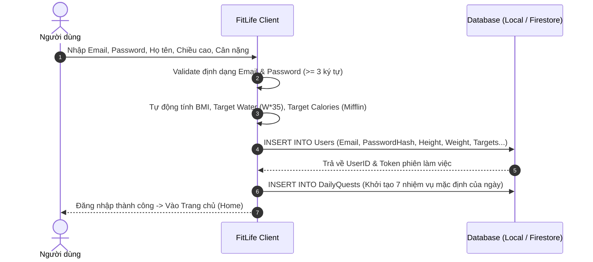
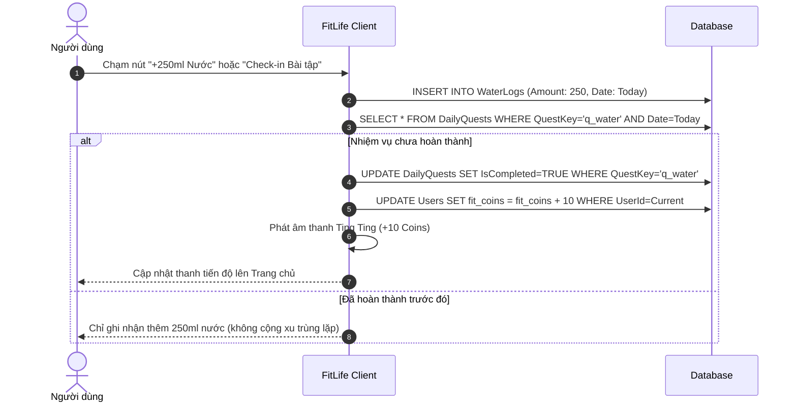
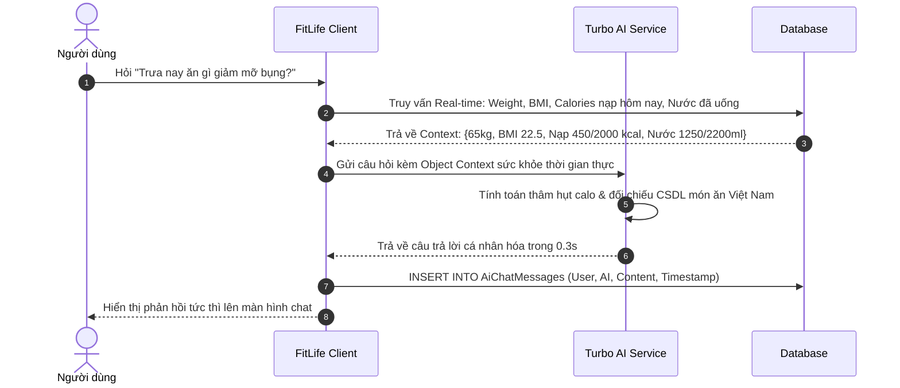

# TÀI LIỆU ĐẶC TẢ NGHIỆP VỤ CƠ SỞ DỮ LIỆU
## DỰ ÁN: FITLIFE HEALTH & MMA (projectMMA)

---

## 1. TỔNG QUAN HỆ THỐNG VÀ KIẾN TRÚC DỮ LIỆU

### 1.1 Mục đích tài liệu
Tài liệu này đặc tả chi tiết kiến trúc cơ sở dữ liệu, lược đồ thực thể quan hệ (ERD), từ điển dữ liệu (Data Dictionary), các ràng buộc toàn vẹn và quy tắc nghiệp vụ (Business Rules) phục vụ việc phát triển, bảo vệ đồ án môn học Lập trình Thiết bị Di động (MMA).

### 1.2 Kiến trúc lưu trữ (Hybrid Local-First & Cloud Architecture)
Hệ thống FitLife áp dụng mô hình kiến trúc **Local-First Synchronization**:
- **Tầng Client (Offline/Local Cache)**: Sử dụng AsyncStorage / SQLite cục bộ để đảm bảo ứng dụng có thể đọc/ghi tức thì trong vòng 5–10ms ngay cả khi thiết bị mất kết nối mạng.
- **Tầng Cloud (Remote Database - Firebase Firestore / Supabase)**: Đồng bộ hai chiều định kỳ hoặc khi có kết nối mạng để lưu trữ tập trung, phục vụ sao lưu và xác thực đa thiết bị.

---

## 2. SƠ ĐỒ THỰC THỂ QUAN HỆ (ERD - ENTITY RELATIONSHIP DIAGRAM)

```mermaid
erDiagram
    USERS ||--o{ WATER_LOGS : "logs"
    USERS ||--o{ WORKOUT_LOGS : "executes"
    USERS ||--o{ MEAL_LOGS : "records"
    USERS ||--o{ DAILY_QUEST_LOGS : "completes"
    USERS ||--o{ BMI_HISTORY : "tracks"
    USERS ||--o{ SLEEP_LOGS : "records"
    USERS ||--o{ MOOD_LOGS : "logs"
    USERS ||--o{ PURCHASES : "redeems"
    USERS ||--o{ USER_CHALLENGES : "joins"
    USERS ||--o{ AI_CHAT_MESSAGES : "chats"

    CHALLENGES ||--o{ USER_CHALLENGES : "participates_in"
    REWARD_ITEMS ||--o{ PURCHASES : "purchased_in"

    USERS {
        string user_id PK "Mã định danh người dùng (UUID)"
        string email UK "Email đăng nhập"
        string password_hash "Mật khẩu mã hóa"
        string full_name "Họ và tên người dùng"
        string gender "Giới tính ('male' | 'female')"
        int age "Tuổi (năm)"
        float height "Chiều cao (cm)"
        float weight "Cân nặng hiện tại (kg)"
        string activity_level "Mức độ vận động (sedentary/light/moderate/active)"
        string goal "Mục tiêu (lose/maintain/gain)"
        int target_water "Mục tiêu nước mỗi ngày (ml)"
        int target_calories "Mục tiêu calo mỗi ngày (kcal)"
        int fit_coins "Số dư xu thưởng tích lũy"
        int streak_days "Chuỗi ngày liên tiếp hoàn thành"
        datetime created_at "Thời điểm tạo tài khoản"
        datetime updated_at "Thời điểm cập nhật gần nhất"
    }

    WATER_LOGS {
        string log_id PK "Mã nhật ký uống nước"
        string user_id FK "Mã người dùng"
        int amount "Lượng nước nạp vào (ml)"
        string log_time "Giờ ghi nhận (HH:mm)"
        date log_date "Ngày ghi nhận (YYYY-MM-DD)"
        datetime created_at "Timestamp hệ thống"
    }

    WORKOUT_LOGS {
        string workout_id PK "Mã buổi tập"
        string user_id FK "Mã người dùng"
        string title "Tên bài tập (HIIT, MMA, Tabata...)"
        string category "Phân loại bài tập (Fullbody, Core, Cardio)"
        int duration_seconds "Thời gian tập luyện (giây)"
        int calories_burned "Năng lượng tiêu hao (kcal)"
        date workout_date "Ngày tập (YYYY-MM-DD)"
        datetime created_at "Timestamp hệ thống"
    }

    MEAL_LOGS {
        string meal_id PK "Mã bữa ăn"
        string user_id FK "Mã người dùng"
        string meal_name "Tên món ăn"
        int calories "Lượng calo (kcal)"
        float protein "Lượng đạm (gram)"
        float carbs "Lượng tinh bột (gram)"
        float fat "Lượng chất béo (gram)"
        string meal_type "Bữa ăn ('breakfast' | 'lunch' | 'dinner' | 'snack')"
        date meal_date "Ngày ăn (YYYY-MM-DD)"
        datetime created_at "Timestamp hệ thống"
    }

    DAILY_QUEST_LOGS {
        string quest_log_id PK "Mã ghi nhận nhiệm vụ"
        string user_id FK "Mã người dùng"
        string quest_key "Khóa nhiệm vụ (q_water, q_workout, q_sleep...)"
        string quest_title "Tên nhiệm vụ hiển thị"
        int reward_coins "Số xu thưởng nhận được"
        boolean is_completed "Trạng thái hoàn thành"
        string extra_value "Giá trị ghi chú (VD: '+250ml', '7.5h')"
        date quest_date "Ngày làm nhiệm vụ (YYYY-MM-DD)"
    }

    BMI_HISTORY {
        string record_id PK "Mã lịch sử thể trạng"
        string user_id FK "Mã người dùng"
        float weight "Cân nặng tại thời điểm đo (kg)"
        float height "Chiều cao tại thời điểm đo (cm)"
        float bmi_value "Chỉ số BMI"
        string bmi_status "Phân loại thể trạng"
        date record_date "Ngày đo"
    }

    SLEEP_LOGS {
        string sleep_id PK "Mã nhật ký giấc ngủ"
        string user_id FK "Mã người dùng"
        float hours "Thời lượng ngủ (giờ)"
        string quality "Đánh giá chất lượng ('Sâu', 'Bình thường', 'Chập chờn')"
        date sleep_date "Ngày ghi nhận"
    }

    MOOD_LOGS {
        string mood_id PK "Mã tâm trạng"
        string user_id FK "Mã người dùng"
        string mood_label "Nhãn tâm trạng ('Sẵn sàng', 'Năng lượng', 'Mệt...')"
        string note "Ghi chú ngắn"
        date mood_date "Ngày ghi nhận"
    }

    CHALLENGES {
        string challenge_id PK "Mã thử thách cộng đồng"
        string title "Tên thử thách"
        string description "Mô tả mục tiêu"
        int target_days "Số ngày cần hoàn thành (VD: 7, 14, 30)"
        int reward_coins "Phần thưởng hoàn thành"
        string badge_icon "Biểu tượng huy hiệu"
        boolean is_active "Trạng thái khả dụng"
    }

    USER_CHALLENGES {
        string id PK "Mã tham gia"
        string user_id FK "Mã người dùng"
        string challenge_id FK "Mã thử thách"
        int current_progress "Tiến độ hiện tại (ngày đã check-in)"
        boolean is_completed "Đã hoàn thành toàn bộ chưa"
        datetime joined_at "Ngày tham gia"
        datetime last_checkin "Thời điểm điểm danh gần nhất"
    }

    REWARD_ITEMS {
        string item_id PK "Mã vật phẩm quà tặng"
        string title "Tên quà / Huy hiệu"
        string category "Phân loại ('badge', 'theme', 'voucher')"
        int cost_coins "Giá đổi bằng xu"
        string icon "Icon hiển thị"
        boolean is_available "Còn hàng trong kho không"
    }

    PURCHASES {
        string purchase_id PK "Mã giao dịch đổi thưởng"
        string user_id FK "Mã người dùng"
        string item_id FK "Mã vật phẩm"
        int spent_coins "Số xu đã trừ"
        datetime purchased_at "Thời điểm giao dịch"
    }

    AI_CHAT_MESSAGES {
        string message_id PK "Mã tin nhắn"
        string user_id FK "Mã người dùng"
        string sender "Người gửi ('user' | 'ai')"
        string content "Nội dung tin nhắn"
        string ai_engine "Mô hình xử lý ('Turbo 0.3s' | 'Gemini 2.5' | 'Cloud')"
        datetime timestamp "Thời gian gửi"
    }
```

---

## 3. TỪ ĐIỂN DỮ LIỆU CHI TIẾT (DATA DICTIONARY)

### 3.1 Bảng `USERS` (Hồ sơ người dùng & Thể trạng)
Lưu thông tin định danh và các chỉ số sinh trắc học cá nhân hóa.

| Tên trường (Field) | Kiểu dữ liệu | Khóa / Ràng buộc | Mô tả ý nghĩa nghiệp vụ |
| :--- | :--- | :--- | :--- |
| `user_id` | VARCHAR(36) | **PK**, Not Null | Mã định danh duy nhất của người dùng. |
| `email` | VARCHAR(100) | **Unique**, Not Null | Email xác thực tài khoản. |
| `password_hash` | VARCHAR(255) | Not Null | Mật khẩu tài khoản (đã băm bảo mật). |
| `full_name` | VARCHAR(100) | Not Null | Họ và tên hiển thị trong Header và lời chào. |
| `gender` | VARCHAR(10) | Default: 'male' | Giới tính sinh học ('male', 'female') phục vụ tính BMR. |
| `age` | INT | Check: 5 $\le$ age $\le$ 100 | Độ tuổi của người dùng. |
| `height` | DECIMAL(5,2) | Check: 80 $\le$ height $\le$ 250 | Chiều cao tính bằng centimet (cm). |
| `weight` | DECIMAL(5,2) | Check: 25 $\le$ weight $\le$ 300 | Cân nặng tính bằng kilogam (kg). |
| `activity_level` | VARCHAR(20) | In: sedentary, light, moderate, active | Hệ số hoạt động thể chất trong ngày. |
| `goal` | VARCHAR(20) | In: lose, maintain, gain | Mục tiêu vóc dáng (Giảm mỡ, Giữ cân, Tăng cơ). |
| `target_water` | INT | Check: $\ge 500$ ml | Mục tiêu nước uống mỗi ngày (tự động tính $w \times 35$). |
| `target_calories`| INT | Check: $\ge 800$ kcal | Mục tiêu năng lượng nạp mỗi ngày (Mifflin-St Jeor). |
| `fit_coins` | INT | Check: $\ge 0$, Default: 0 | Số dư xu ảo tích lũy được từ nhiệm vụ. |
| `streak_days` | INT | Check: $\ge 0$, Default: 0 | Chuỗi ngày liên tiếp đăng nhập & hoàn thành mục tiêu. |
| `created_at` | DATETIME | Not Null | Thời điểm đăng ký tài khoản. |

---

### 3.2 Bảng `WATER_LOGS` (Nhật ký uống nước)
Ghi nhận từng lần uống nước trong ngày phục vụ tính toán phần trăm hoàn thành.

| Tên trường | Kiểu dữ liệu | Ràng buộc | Ý nghĩa nghiệp vụ |
| :--- | :--- | :--- | :--- |
| `log_id` | VARCHAR(36) | **PK** | Mã lần uống nước. |
| `user_id` | VARCHAR(36) | **FK** $\rightarrow$ `USERS` | Mã người dùng thực hiện. |
| `amount` | INT | Check: $> 0$ ml | Lượng nước nạp vào (VD: 150ml, 250ml, 500ml). |
| `log_time` | VARCHAR(8) | Format: 'HH:mm' | Giờ uống (VD: '08:30'). |
| `log_date` | DATE | Format: 'YYYY-MM-DD' | Ngày ghi nhận (dùng để lọc trong ngày và thống kê tuần). |

---

### 3.3 Bảng `WORKOUT_LOGS` (Nhật ký tập luyện MMA / HIIT)
Lưu trữ phiên tập, thời gian và lượng calo tiêu hao từ các bài tập thể lực.

| Tên trường | Kiểu dữ liệu | Ràng buộc | Ý nghĩa nghiệp vụ |
| :--- | :--- | :--- | :--- |
| `workout_id` | VARCHAR(36) | **PK** | Mã phiên tập. |
| `user_id` | VARCHAR(36) | **FK** $\rightarrow$ `USERS` | Mã người dùng tập luyện. |
| `title` | VARCHAR(150) | Not Null | Tên bài tập (VD: 'Tabata 15 phút', 'MMA Shadow Boxing'). |
| `category` | VARCHAR(50) | Not Null | Nhóm bài tập: 'Cardio', 'Core/Bụng', 'Fullbody'. |
| `duration_seconds`| INT | Check: $> 0$ | Tổng số giây tập luyện. |
| `calories_burned` | INT | Check: $\ge 0$ | Số calo đã đốt cháy thực tế. |
| `workout_date` | DATE | Not Null | Ngày thực hiện bài tập. |

---

### 3.4 Bảng `MEAL_LOGS` (Nhật ký dinh dưỡng)
Ghi chép thức ăn nạp vào kèm thông số Macro (Protein, Carbs, Fat).

| Tên trường | Kiểu dữ liệu | Ràng buộc | Ý nghĩa nghiệp vụ |
| :--- | :--- | :--- | :--- |
| `meal_id` | VARCHAR(36) | **PK** | Mã bữa ăn. |
| `user_id` | VARCHAR(36) | **FK** $\rightarrow$ `USERS` | Mã người dùng. |
| `meal_name` | VARCHAR(150) | Not Null | Tên món ăn (VD: '1 tô phở bò tái', 'Ức gà áp chảo'). |
| `calories` | INT | Check: $> 0$ | Lượng calo nạp vào. |
| `protein` | DECIMAL(5,1) | Unit: gram | Hàm lượng chất đạm. |
| `carbs` | DECIMAL(5,1) | Unit: gram | Hàm lượng tinh bột. |
| `fat` | DECIMAL(5,1) | Unit: gram | Hàm lượng chất béo. |
| `meal_type` | VARCHAR(20) | In: breakfast, lunch, dinner, snack | Thời điểm ăn trong ngày. |
| `meal_date` | DATE | Not Null | Ngày ghi nhận bữa ăn. |

---

### 3.5 Bảng `DAILY_QUEST_LOGS` (Nhiệm vụ hàng ngày)
Quản lý trạng thái hoàn thành 7 nhiệm vụ vàng mỗi ngày.

| Tên trường | Kiểu dữ liệu | Ràng buộc | Ý nghĩa nghiệp vụ |
| :--- | :--- | :--- | :--- |
| `quest_log_id` | VARCHAR(36) | **PK** | Mã phiên nhiệm vụ. |
| `user_id` | VARCHAR(36) | **FK** $\rightarrow$ `USERS` | Người thực hiện nhiệm vụ. |
| `quest_key` | VARCHAR(50) | Not Null | Mã định danh nhiệm vụ (`q_water`, `q_workout`, `q_sleep`...). |
| `reward_coins`| INT | Default: 10 | Phần thưởng nhận được khi xong nhiệm vụ (+10 coins). |
| `is_completed` | BOOLEAN | Default: FALSE | Đã hoàn thành trong ngày chưa. |
| `quest_date` | DATE | Not Null | Ngày của chu kỳ nhiệm vụ. |

---

### 3.6 Bảng `REWARD_ITEMS` & `PURCHASES` (Cửa hàng đổi quà - Shop)
Quản lý vật phẩm và lịch sử tiêu thụ FitCoins.

| Bảng | Tên trường | Kiểu dữ liệu | Ý nghĩa nghiệp vụ |
| :--- | :--- | :--- | :--- |
| `REWARD_ITEMS` | `item_id` (PK) | VARCHAR(36) | Mã vật phẩm trong Shop. |
| | `title` | VARCHAR(100) | Tên huy hiệu / quà tặng (VD: 'Huy hiệu Chiến binh MMA'). |
| | `cost_coins` | INT | Số xu cần để mua (VD: 50 xu, 120 xu). |
| `PURCHASES` | `purchase_id` (PK) | VARCHAR(36) | Mã giao dịch mua đồ. |
| | `user_id` (FK) | VARCHAR(36) | Người dùng thực hiện mua. |
| | `item_id` (FK) | VARCHAR(36) | Vật phẩm được mua. |
| | `spent_coins` | INT | Số xu thực tế bị trừ. |
| | `purchased_at` | DATETIME | Thời điểm mua hàng thành công. |

---

## 4. QUY TẮC NGHIỆP VỤ DỮ LIỆU (BUSINESS RULES)

### 4.1 Quy tắc Tính toán Y khoa & Dinh dưỡng
1. **Chỉ số BMI (Body Mass Index)**:
   $$\text{BMI} = \frac{\text{Cân nặng (kg)}}{(\text{Chiều cao (m)})^2}$$
   - $\text{BMI} < 18.5$: Thiếu cân.
   - $18.5 \le \text{BMI} < 23$: Cân đối (Chuẩn người châu Á).
   - $23 \le \text{BMI} < 25$: Thừa cân nhẹ.
   - $\text{BMI} \ge 25$: Tiền béo phì / Béo phì.
2. **Nhu cầu Nước chuẩn hàng ngày**:
   $$\text{Nước mục tiêu (ml)} = \text{Cân nặng (kg)} \times 35\text{ ml}$$
   *(Nếu có tập luyện thể thao ra mồ hôi: tự động cộng thêm $350 - 500\text{ ml}$).*
3. **Mục tiêu Calo (Công thức Mifflin-St Jeor & TDEE)**:
   - **Nam**: $\text{BMR} = 10 \times W + 6.25 \times H - 5 \times A + 5$
   - **Nữ**: $\text{BMR} = 10 \times W + 6.25 \times H - 5 \times A - 161$
   - $\text{TDEE} = \text{BMR} \times \text{Hệ số vận động}$
     - Ít vận động: $1.2$
     - Vận động nhẹ: $1.375$
     - Vừa phải: $1.55$
     - Năng động: $1.725$
   - Điều chỉnh mục tiêu:
     - Giảm mỡ: $\text{TDEE} - 500\text{ kcal}$
     - Giữ cân: $\text{TDEE}$
     - Tăng cơ: $\text{TDEE} + 400\text{ kcal}$

---

### 4.2 Quy tắc Gamification & Thưởng Điểm
1. **Chu kỳ Nhiệm vụ ngày (Daily Reset)**:
   - Toàn bộ danh sách nhiệm vụ được làm mới vào lúc `00:00:00` mỗi ngày.
   - Mỗi nhiệm vụ hoàn thành chỉ được nhận thưởng **duy nhất 01 lần/ngày** (+10 Coins).
   - Hoàn thành đủ 7 nhiệm vụ trong ngày $\rightarrow$ Tự động tăng chuỗi `streak_days` lên +1.
2. **Giao dịch Cửa hàng (Shop)**:
   - Người dùng chỉ được mua vật phẩm khi: $\text{fit\_coins} \ge \text{cost\_coins}$.
   - Khi giao dịch thành công:
     $$\text{fit\_coins}_{\text{mới}} = \text{fit\_coins}_{\text{cũ}} - \text{cost\_coins}$$
   - Mỗi huy hiệu danh hiệu vĩnh viễn chỉ được mua 01 lần (Unique per User).

---

## 5. CÁC LUỒNG NGHIỆP VỤ CRUD CHÍNH

### 5.1 Luồng Khởi tạo Hồ sơ & Đăng ký (Onboarding Flow)

### 5.2 Luồng Điểm Danh & Hoàn Thành Nhiệm Vụ (Quest Completion Flow)

### 5.3 Luồng Tiêm Ngữ Cảnh Vào AI Coach (AI Context Injection Flow)

---

## 6. ĐÁNH GIÁ VÀ HƯỚNG MỞ RỘNG
- **Tính khả thi**: Thiết kế schema ở trên tương thích 100% với cả **NoSQL Document Database (Firebase Firestore)** lẫn **Relational Database (SQLite / PostgreSQL / MySQL)**.
- **Khả năng mở rộng**: Cấu trúc bảng phân tách độc lập (Decoupled), sẵn sàng mở rộng thêm bảng `COMMUNITY_POSTS` (chia sẻ khoảnh khắc tập luyện) và `NOTIFICATIONS_QUEUE` trong tương lai.
