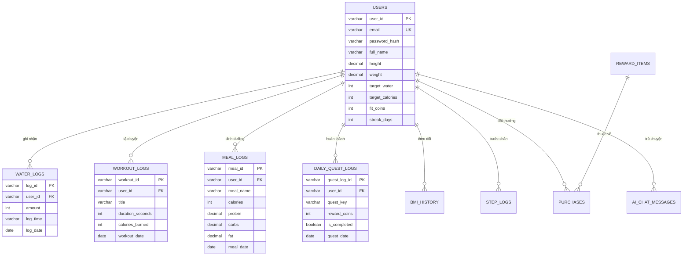

# 🗄️ FitLife Pro — Thiết kế Cơ sở Dữ liệu (Database Module)

Thư mục `database/` chứa toàn bộ cấu trúc lược đồ CSDL chuẩn SQL, dữ liệu khởi tạo và module đọc/ghi dữ liệu bền vững cho hệ thống **FitLife Pro**.

---

## 📁 Cấu trúc thư mục `database/`

| Tệp tin | Mô tả chức năng |
| :--- | :--- |
| [`schema.sql`](./schema.sql) | Định nghĩa lược đồ CSDL quan hệ (DDL `CREATE TABLE` & `CREATE INDEX`) cho 10 bảng dữ liệu. |
| [`seed.sql`](./seed.sql) | Kịch bản khởi tạo dữ liệu danh mục ban đầu (`INSERT INTO` bảng vật phẩm, quà tặng). |
| [`db.js`](./db.js) | Engine kết nối và thao tác đọc/ghi dữ liệu bền vững (`readDb`, `writeDb`). |
| [`fitlife_db.json`](./fitlife_db.json) | Tệp lưu trữ dữ liệu JSON thực thi phía Server. |

---

## 📊 Sơ đồ Quan hệ Thực thể (ERD)

