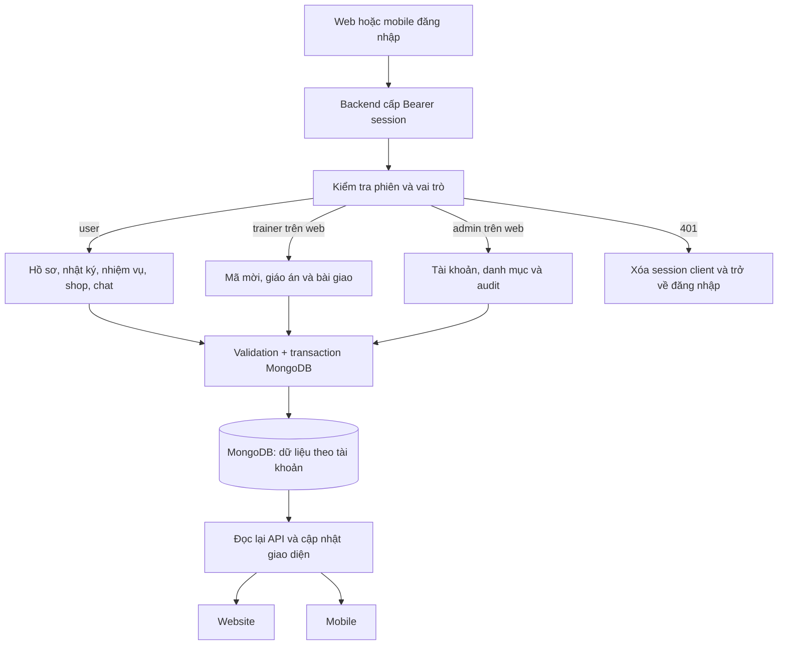

# Kiểm tra và tích hợp FitLife — 04/11/2026

## Phạm vi, Git và kiến trúc thực tế

Repository: `https://github.com/ducvt1690/FitlifeMoblie.git`. Nhánh backend có tên chính xác là **`thông`** (có dấu), HEAD `9d1ae1230ce39499bbb5bcdc70ac2a1a7cfd5537`. Không có nhánh local tên ASCII `thong`. Công việc trong lượt này chỉ sửa local, **không commit, merge hoặc push**.

Worktree thực hiện: `C:\Users\thong\.codex\worktrees\merge-web-fe-thong\FitlifeMoblie`. Thư mục đang được chọn khi bắt đầu khảo sát (`main-frontend-mobile`) thực tế ở `hoang/sleep-mood-api`, vì vậy không chuyển nhánh hoặc sửa code ở đó. Worktree `main` tại `C:\hoc tap\FitlifeMoblie` có chỉnh sửa chưa commit; được giữ nguyên. Những commit được tạo/push ở các lượt trước không phải thao tác của lượt này.

| Module | Công nghệ, dữ liệu và cách hoạt động |
|---|---|
| `backend/` | Node.js/Express 4, MongoDB driver; route → service → transaction → MongoDB |
| `web/` | React 19/Vite, React Router, Bearer auth; ba khu `/app`, `/trainer`, `/admin` |
| `frontend/` | React Native/Expo; đã đồng bộ SDK 58 với Expo Go 58 trên emulator; mobile chỉ cho role `user` |
| `backend/database/mongodb/` | 19 collection nghiệp vụ; `auth_sessions` lưu hash token và hạn phiên; schema/index/migration/seed |
| Kiểm thử | Node test runner, MongoDB replica set tạm, Postman CLI, Playwright/Edge, Android ADB/UIAutomator |

Package manager: npm, dùng lockfile của từng module. Backend bình thường cần `MONGODB_URI` và `MONGODB_DB_NAME=fitlife`. Trong worktree này không có `.env` Atlas để nghiệm thu; toàn bộ kiểm thử dữ liệu dùng MongoDB thật trong replica set tạm, không dùng mock response để chứng minh đồng bộ. Dữ liệu mẫu trong server QA được ghi rõ là fixture, không phải dữ liệu Atlas.

## Tiêu chí chấp nhận và nguồn nghiệp vụ

Quy tắc hiện dùng lấy từ `backend/api/features.md`, `profile.md`, `meals.md`, `workouts.md` và tài liệu role của dự án. Đây là hợp đồng hiện có của dự án, không phải chính sách sản phẩm mới do lượt kiểm tra này tự đặt ra.

| ID | Bối cảnh và thao tác | Kết quả quan sát được | Điều không được xảy ra | Xác minh |
|---|---|---|---|---|
| AC-01 | Thành viên đăng ký/đăng nhập mobile | Tạo/lấy user và phiên từ backend; đăng ký kèm onboarding hợp lệ | Không xác thực bằng danh sách mật khẩu local | Integration test + mobile UI đăng ký + Android native đăng nhập |
| AC-02 | Ghi/sửa dữ liệu trên một client rồi mở client còn lại | Cùng tài khoản thấy cùng nước/bữa ăn/xu trên web và mobile | Không dùng dữ liệu giả để thay API lỗi | Playwright xuyên mobile → API → MongoDB → web và ngược lại |
| AC-03 | Lặp request hoặc thực hiện hai lần trong ngày | Server quyết định xu, quest, streak, quyền sở hữu và check-in | Không tự cộng xu/chỉnh quest từ client | Backend tests, Postman, mobile adapter integration |
| AC-04 | Phiên hết hạn hoặc đổi tài khoản khi response cũ đang đọc | Trở lại login hoặc từ chối response của phiên cũ | Không hiện nhật ký tài khoản trước, không fallback auth local | Integration + E2E lỗi 401 có chủ đích |
| AC-05 | Mất response chat sau khi server đã lưu | Retry cùng UUID trả lại reply đã có, không tạo tin/thưởng lặp | Không thay lỗi mạng bằng câu trả lời local giả thành công | Fault injection qua browser + MongoDB integration |
| AC-06 | Tìm kiếm web có response về sai thứ tự | Chỉ kết quả của bộ lọc mới nhất được hiển thị | Response cũ không ghi đè dữ liệu mới | Playwright kiểm soát thứ tự response |
| AC-07 | Mở app trên Android emulator | Expo Go tải được app, xác thực với backend, hiển thị hồ sơ và quest thật | Không coi export bundle là đã chạy native | ADB/UIAutomator, XML và screenshot |
| AC-08 | API không khả dụng hoặc dữ liệu rỗng | Loading/error/empty/retry hiển thị; chỉ báo thành công sau khi API đạt | Không giả lập nhịp tim, bước chân hoặc trạng thái sở hữu | Browser E2E 503/retry/empty search + kiểm tra source |



## API, database, web và mobile

[Ma trận đầy đủ](API_MATRIX.md) liệt kê **60 cặp HTTP method/path nghiệp vụ thuộc 17 nhóm**, cùng collection bị tác động, màn hình consumer và test. Ngoài ra có `GET /` và `GET /health`.

| Phân loại | Kết quả |
|---|---|
| Đã triển khai và kiểm tra | Auth/session; profile; water/workout/meal; bài tập; quest/check-in; sleep/mood/BMI; challenge; reward; stats; chat; coaching; trainer/admin |
| Có backend, mobile chưa tích hợp trước lượt này | Đã nối các luồng chính trong `frontend/src/utils/storage.js` và các màn hình tương ứng |
| Có backend, UI chưa sử dụng đầy đủ trước lượt này | Đã nối `PATCH /api/meal-logs/:mealId` vào cả web và mobile; dùng lại form hiện có |
| API mới được thêm trong lượt này | **0**. API hiện có đáp ứng các luồng đã tích hợp; không thêm endpoint trùng chức năng |
| Chức năng có API nhưng UI không cần gọi riêng | Endpoint chi tiết bài tập và ghi BMI độc lập vẫn được API test; các trang có thể dùng dữ liệu đã trả từ danh sách/hồ sơ |
| Trainer/admin mobile | Không áp dụng theo hợp đồng dự án; app từ chối đăng nhập các role này và hướng sang website |

Postman collection review là bộ request/assertion dùng chung để kiểm tra các boundary HTTP, kết hợp các tài liệu contract đã có; không tạo một bộ contract mới trái với các tên field hiện tại. Mobile giữ lớp mapping camelCase của màn hình ↔ snake_case của backend, và được kiểm thử qua request thực tế. UUID được giữ khi tự retry thao tác hỗ trợ idempotency.

## Những thay đổi đã thực hiện

- Thay luồng tài khoản, mật khẩu và sức khỏe trong AsyncStorage bằng API thật; token native dùng `expo-secure-store`. Expo web dùng sessionStorage theo tab; backend kiểm tra expiry/ownership. Dữ liệu local cũ không bị tự chuyển hoặc xóa.
- Đăng ký mobile thu thập tuổi, chiều cao, cân nặng, giới tính, mức vận động và mục tiêu; không trim mật khẩu. Bỏ đường vào guest/demo dùng dữ liệu giả cho tài khoản server.
- Nối hồ sơ, nhật ký nước/tập/bữa ăn, sửa/xóa bữa ăn, BMI, ngủ/tâm trạng, thống kê; lỗi HTTP được hiển thị và có retry.
- Đồng nhất 7 quest, xu, streak, catalog shop và challenge với server. Bỏ các bước tự thưởng xu, giả lập progress và mặc định đã sở hữu đồ trên thiết bị.
- Chat mobile dùng `/api/chat`; lịch sử thật, chuyển session và retry UUID; không gọi cloud AI trực tiếp từ thiết bị hoặc giả trả lời thành công khi backend lỗi.
- Thêm phần thành viên nhận mã mời HLV, xem bài giao, hoàn thành/từ chối và ngắt kết nối bằng các API coaching sẵn có.
- Thư viện bài tập đọc API và hỗ trợ tìm kiếm, lọc, phân trang. Timer không còn thực hiện side effect bên trong state updater; UUID buổi tập giữ ổn định.
- Bỏ nhịp tim/bước chân mô phỏng, chỉ số readiness 98% và tuyên bố AI 0.3 giây không được đo. Các phần chưa có thiết bị hiển thị trạng thái chưa có dữ liệu.
- Sửa race giữa initial load của mobile và feedback loader; chặn response thuộc phiên cũ; thêm loading/error/retry dùng chung. Modal có xử lý Android back.
- Sửa `web/src/lib/useLoad.js` để request cũ không ghi đè kết quả lọc mới; thêm E2E tái hiện trước khi sửa và chạy đạt sau sửa.
- Vite đọc `VITE_API_PROXY` từ file môi trường qua `loadEnv`; không chỉ đọc biến process.
- Đồng bộ Expo 57 → 58 và các package tương thích do emulator có Expo Go 58; giữ React Native/Expo, không đổi framework. Sửa thông báo để không báo đã lên lịch trên web khi chưa hỗ trợ; cập nhật kiểu daily trigger.
- Thêm server local QA an toàn, môi trường Postman, test adapter/mobile, test web/cross-platform, native smoke và lệnh tái chạy.

## Kết quả kiểm thử

Các con số dưới đây phân biệt test case, HTTP request và assertion; không cộng chúng thành một số coverage giả.

| Bộ kiểm tra | PASS | FAIL | BLOCKED | NOT RUN | Bằng chứng |
|---|---:|---:|---:|---:|---|
| Backend Node integration/unit | 91 | 0 | 0 | 0 | `backend/postman/qa-backend-tests.txt` |
| Database/schema/migration/rollback | 40 | 0 | 0 | 0 | `backend/postman/qa-database-tests.txt` |
| Mobile adapter với backend/MongoDB | 9 | 0 | 0 | 0 | `frontend/tests/server-integration.test.cjs` |
| Postman review assertion | 165 | 0 | 0 | 0 | 121 request, `backend/postman/qa-postman-review.txt` |
| E2E xuyên web–mobile | 10 | 0 | 0 | 0 | `qa-artifacts/cross-platform.json` |
| Web race response sai thứ tự | 1 | 0 | 0 | 0 | `web/tests/race-regression.cjs` |
| Smoke web ba role | 3 role / 19 trang | 0 | 0 | 0 | `qa-artifacts/roles-smoke.json`; kiểm tra nav/login/logout, không phải 19 full business E2E |
| Android native smoke | 1 luồng | 0 | 0 | 0 | `qa-artifacts/android/result.json`, `quests.xml`, `quests.png` |
| Atlas thật | 0 | 0 | 1 | 0 | Không có cấu hình/credentials Atlas trong worktree |
| Gọi AI trả phí thật | 0 | 0 | 1 | 0 | Không có key; đã kiểm tra coach theo quy tắc trên backend |
| iOS native UI | 0 | 0 | 1 | 0 | Host Windows không có iOS Simulator; bundle iOS đã export |
| Thiết bị đo bước chân/nhịp tim | 0 | 0 | 1 | 0 | Không có thiết bị/tích hợp sensor để xác minh |
| Lịch thông báo chạy theo giờ thực | 0 | 0 | 0 | 1 | Chưa chờ các mốc giờ trên thiết bị; không kết luận PASS |
| Visual regression so baseline và screen reader | 0 | 0 | 0 | 1 | Có screenshot/kiểm tra tràn ngang; chưa có baseline hoặc full audit accessibility |

Backend + database + mobile adapter: **140 test đạt, không test bị skip**. Test có cả input thiếu/sai kiểu, biên, duplicate ID, UUID conflict, không token, token expiry, role khác, ownership, transaction rollback và lỗi ghi phản hồi chat. Bốn regression backend từ lượt trước tiếp tục đạt. Test đăng ký mobile trước sửa đã chứng minh không có user trong database; sau sửa có user thực. Web race được tái hiện đỏ rồi kiểm tra xanh. Hai lần đầu native automation cần sửa cách chờ bàn phím/focus; không đổi expected của ứng dụng để làm test đạt.

Build backend kiểm tra cú pháp; frontend check phân tích syntax, unbound identifiers và relative export/import. Vite production build và Expo export Android/iOS/web đã chạy. Native Android mở bằng Expo Go 58.0.5 trên AVD `FitLife_API36`; đăng nhập và tải dữ liệu server đã quan sát qua UIAutomator. Không coi export bundle là bằng chứng tạo APK/IPA release.

Ảnh chụp web tại 375/768/1440 px không thấy tràn ngang trên dashboard. Chưa có baseline nên visual regression được ghi NOT RUN, không coi là đã đạt thiết kế hoặc WCAG đầy đủ.

## Kiểm tra bảo mật và giới hạn còn lại

- Backend đã có test phân quyền và dữ liệu giữa tài khoản; phía mobile không còn tin số xu/quyền do local gửi lên và không lưu password mới. Data của tài khoản trước bị từ chối cả khi response JSON về chậm sau đổi session.
- `npm audit` frontend ghi nhận **7 advisory moderate, 0 high/critical**, chủ yếu chuỗi dependency tooling Expo/ngrok/glob/minimatch/uuid. Một số đề nghị của npm là hạ Expo về SDK 53 hoặc không có fix; không dùng `audit fix --force` để phá tương thích SDK58. Đây là rủi ro dependency còn tồn tại, không được ghi là audit sạch.
- Local tài khoản/nhật ký trước đây không được tự migrate sang tài khoản server vì chưa có cách xác minh ownership đáng tin. Không xóa dữ liệu cũ hoặc dùng password local để bypass backend.
- Manual retry ghi nước/bữa ăn sau khi cả các lần tự retry đều mất response cần quy tắc lưu request UUID bền qua việc rời màn hình; chưa có offline queue hoặc backfill ngày cũ. Chat giữ UUID khi retry tại màn hình; lịch sử server có thể tải lại.
- Các API đã có chưa bao gồm quên mật khẩu qua email, xóa tài khoản, xuất dữ liệu, trang bị theme/badge hay redeem voucher. Không tạo nghiệp vụ mới khi chưa có contract sản phẩm. UI không tuyên bố vật phẩm mua xong đã tự trang bị.
- Nhật ký nước/tập hiện append-only theo API; không giả lập nút xóa dữ liệu server hoặc cho thay mục tiêu nước bằng số local. Muốn thêm undo cần định nghĩa hoàn tác xu/quest/mục tiêu/streak trước.

### Hợp đồng đề xuất cho phần thiếu có điều kiện

Khôi phục khi quên mật khẩu cần dịch vụ gửi email xác minh chưa được cấu hình. Nếu đưa vào phạm vi sản phẩm, đề xuất:

| Endpoint dự kiến | Input/output | Quyền/validation | Database và consumer | Acceptance/test |
|---|---|---|---|---|
| `POST /api/auth/password-reset-requests` | `{email}` → `202 {success:true}` giống nhau dù tài khoản có/không tồn tại | Anonymous; canonical email, giới hạn theo IP/email; không lộ account existence | Token hash có expiry một lần trong collection riêng; gửi email thật; màn quên mật khẩu web/mobile | Email đến test inbox, unknown email vẫn 202, rate limit 429, không log raw token |
| `POST /api/auth/password-resets` | `{token,new_password}` → 200 hoặc 400 cho token không hợp lệ | Token đủ ngẫu nhiên, có hạn, dùng một lần; mật khẩu theo contract đăng ký; transaction | Cập nhật password hash, đánh dấu token dùng rồi và thu hồi tất cả `auth_sessions`; web/mobile quay lại login | Token hết hạn/dùng lại/sai đều bị từ chối, mật khẩu cũ không đăng nhập, mọi session cũ 401, lỗi ghi rollback |

Hai endpoint này **chưa được tạo** vì thiếu email provider và chính sách phát hành token; không có mock email được trình bày như đã tích hợp. API đo cảm biến, equip/redeem, water/workout undo hoặc export/delete account cần phạm vi và quy tắc dữ liệu riêng trước khi thêm.

## Ứng dụng đã khởi động và chạy lại

| Thành phần | Địa chỉ/thiết bị đã chạy |
|---|---|
| Express + MongoDB QA | `http://127.0.0.1:5500`; `/health` ping database thật |
| Website Vite | `http://127.0.0.1:5175`; proxy API → 5500 |
| App Expo trên trình duyệt | `http://127.0.0.1:8085`; API → 5500 |
| Android native | `exp://127.0.0.1:8085`, qua `adb reverse` cổng 8085/5500 |

Từ worktree `thông`, các terminal riêng:

```powershell
# Chuẩn bị dependencies nếu checkout mới
npm --prefix backend ci
npm --prefix web ci
npm --prefix frontend ci

# Terminal 1: server QA, không dùng Atlas/.env
npm run qa:api

# Terminal 2: web; web/.env.local đặt VITE_API_PROXY=http://127.0.0.1:5500
cd web
npm run dev -- --host 127.0.0.1 --port 5175 --strictPort

# Terminal 3 (chạy từ frontend/)
# frontend/.env.local đặt EXPO_PUBLIC_API_URL=http://127.0.0.1:5500
cd frontend
node node_modules/expo/bin/cli start --port 8085 --offline
```

Mỗi terminal bắt đầu từ thư mục gốc của worktree. Vite chạy từ `web` để đọc đúng `.env.local` và config; Expo chạy từ `frontend`.

Android: bật AVD, cấu hình `ANDROID_SDK_ROOT` hoặc SDK mặc định trong `%LOCALAPPDATA%\Android\Sdk`, sau đó trong `frontend/` chạy `npm run test:android`. Script dùng Expo Go đã cài, không tự xóa dữ liệu emulator. Với điện thoại thật, đặt API URL là IP LAN của máy chạy backend và cấu hình bind/CORS thích hợp; localhost của điện thoại không phải localhost của PC.

Kiểm thử:

```powershell
npm --prefix backend run build
npm --prefix backend test
npm --prefix backend/database/mongodb test
npm --prefix backend run test:postman:review
npm --prefix frontend run check
npm --prefix frontend test
npm --prefix frontend run export:all
npm --prefix web run build
npm --prefix web run test:e2e
node backend/scripts/build-qa-matrix.js
```

Postman CLI phải có trên máy để chạy runner review; không cần đăng nhập/publish Cloud. Có thể import `backend/api/FitLife-QA.local.postman_environment.json`; collection review cần fixtures do runner chuẩn bị, không import chạy tùy tiện trên Atlas thật. Playwright dùng Edge mặc định trên máy này; đặt `FITLIFE_BROWSER_CHANNEL` nếu dùng Chrome có sẵn. Các E2E yêu cầu ba server local ở trên đang chạy. Nhánh chính và cấu hình production không bị sửa bởi bộ QA.

Logs/screenshot thô nằm trong `qa-artifacts/` và `backend/postman/`, được Git bỏ qua. Tài liệu, code và test của lượt này vẫn để **uncommitted** để người dùng review.
